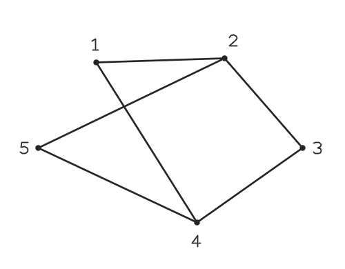

> [!ex] [Exercise 01 (Adjacency Matrix to Drawing)](Exercise%2001%20%28Adjacency%20Matrix%20to%20Drawing%29.md): For the graph with the adjacency matrix below left, find the adjacency list and a drawing of it.
>
> $$
> \begin{bmatrix}
> 0&1&0&1&0\\
> 1&0&1&0&1\\
> 0&1&0&1&0\\
> 1&0&1&0&1\\
> 0&1&0&1&0
> \end{bmatrix}
> \qquad
> \begin{bmatrix}
> 0&1&1&0&1&1\\
> 1&0&0&1&0&1\\
> 1&0&0&0&1&0\\
> 0&1&0&0&0&1\\
> 1&0&1&0&0&1\\
> 1&1&0&1&1&0
> \end{bmatrix}
> $$

###### Solution.
> [!sol] *Solution.* Reading the columns with entry $1$ in each row gives the adjacency list.
>
> $$
> \begin{aligned}
> 1 &\colon 2,4 \\
> 2 &\colon 1,3,5 \\
> 3 &\colon 2,4 \\
> 4 &\colon 1,3,5 \\
> 5 &\colon 2,4
> \end{aligned}
> $$
>
> 
>
> The drawing has edges $12,14,23,25,34,45$. The five marked points are the vertices. $\blacksquare$

###### Dependencies.
- [Definition 5 (Adjacency Matrix)](../Definition%205%20%28Adjacency%20Matrix%29.md)
- [Definition 6 (Drawing Of A Graph)](../Definition%206%20%28Drawing%20Of%20A%20Graph%29.md)

###### References.
[1] Bickle, A. (2020). *Fundamentals of graph theory*. American Mathematical Society. (p. 25 (42)). Section 1.2, Exercise 11.

#mathematics #graph-theory #exercise
