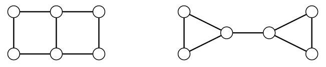

> [!ex] [Exercise 02 (Drawing to Adjacency Matrix)](Exercise%2002%20%28Drawing%20to%20Adjacency%20Matrix%29.md): For the graph drawn below left, find its adjacency matrix.
>
> 

###### Dependencies.
- [Definition 5 (Adjacency Matrix)](../Definition%205%20%28Adjacency%20Matrix%29.md)
- [Definition 6 (Drawing Of A Graph)](../Definition%206%20%28Drawing%20Of%20A%20Graph%29.md)

###### References.
[1] Bickle, A. (2020). *Fundamentals of graph theory*. American Mathematical Society. (p. 25 (42)). Section 1.2, Exercise 13.

#mathematics #graph-theory #exercise
