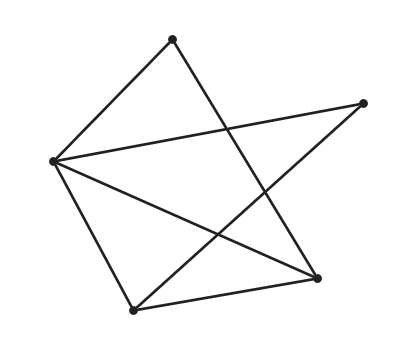

> [!ex] [Exercise 05 (Degree Sequence With Maximum Four)](Exercise%2005%20%28Degree%20Sequence%20With%20Maximum%20Four%29.md): How many edges does a graph have if its degree sequence is $4, 3, 3, 2, 2$? Draw such a graph.

###### Solution.
> [!sol] *Solution.* By the [Handshaking Lemma](../Theorem%201%20%28First%20Theorem%20Of%20The%20Graph%20Theory%29.md), the number of edges is
>
> $$
> |E(G)|=\frac{4+3+3+2+2}{2}=7.
> $$
>
> 
>
> The leftmost vertex has degree $4$, the two bottom vertices have degree $3$, and the top and upper-right vertices have degree $2$. $\blacksquare$

###### Dependencies.
- [Definition 7 (Order And Size)](../Definition%207%20%28Order%20And%20Size%29.md)
- [Definition 10 (Degree Sequence And Regularity)](../Definition%2010%20%28Degree%20Sequence%20And%20Regularity%29.md)
- [Theorem 1 (First Theorem Of The Graph Theory)](../Theorem%201%20%28First%20Theorem%20Of%20The%20Graph%20Theory%29.md)

###### References.
[1] Bickle, A. (2020). *Fundamentals of graph theory*. American Mathematical Society. (p. 26 (43)). Section 1.3, Exercise 3.

#mathematics #graph-theory #exercise
