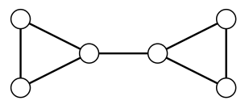

> [!ex] [Exercise 07 (Minimum Maximum and Average Degree)](Exercise%2007%20%28Minimum%20Maximum%20and%20Average%20Degree%29.md): For the graph in Exercise 14 of Section 1.2, find the minimum degree, maximum degree, and average degree.
>
> 

###### Solution.
> [!sol] *Solution.* The two endpoints of the edge joining the triangles have degree $3$. The other four vertices have degree $2$. Thus $\delta(G)=2$ and $\Delta(G)=3$. The average degree is $\overline{d}(G)=\frac{2\cdot3+4\cdot2}{6}=\frac{14}{6}=\frac{7}{3}$. $\blacksquare$

###### Dependencies.
- [Definition 9 (Degree And Neighborhood)](../Definition%209%20%28Degree%20And%20Neighborhood%29.md)
- [Definition 10 (Degree Sequence And Regularity)](../Definition%2010%20%28Degree%20Sequence%20And%20Regularity%29.md)

###### References.
[1] Bickle, A. (2020). *Fundamentals of graph theory*. American Mathematical Society. (pp. 26 (43), 25 (42)). Section 1.3, Exercise 5.

#mathematics #graph-theory #exercise
