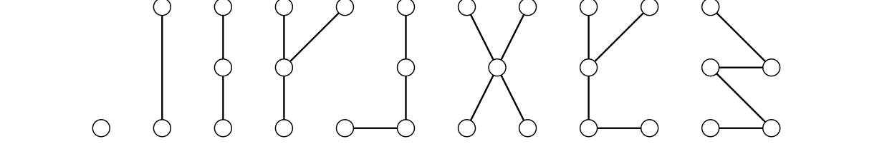

> [!def] [Definition 35 (Trees and Forests)](Definition%2035%20%28Trees%20and%20Forests%29.md): A **forest**, or **acyclic graph**, is a graph with no cycles. A **tree** is a connected forest.

> [!rem] Remark. The components of a forest are trees. Trees are minimally connected and maximally acyclic on their vertex set. A **leaf** is a vertex of degree $1$.

###### Examples.
> [!eg] Ex. 1: Paths and stars are trees. Among trees of the same order, they sit at opposite extremes for diameter and maximum degree.

> [!eg] Ex. 2: The trees of orders $1$ through $5$ are shown by order.
> 

###### Dependencies.
- [Definition 12 (Paths And Cycles)](../Chapter%201/Definition%2012%20%28Paths%20And%20Cycles%29.md)
- [Definition 25 (Complete Bipartite Graphs And Stars)](../Chapter%201/Definition%2025%20%28Complete%20Bipartite%20Graphs%20And%20Stars%29.md)
- [Definition 31 (Connectivity And Components)](../Chapter%201/Definition%2031%20%28Connectivity%20And%20Components%29.md)

###### References.
[1] Bickle, A. (2020). *Fundamentals of graph theory*. American Mathematical Society. (p. 35 (52)). Source definition 2.1.

#mathematics #graph-theory #definition
