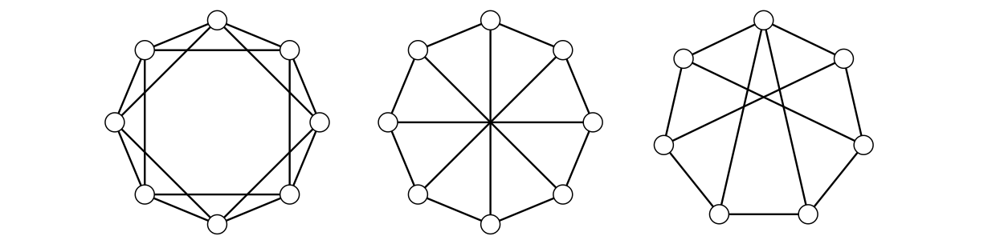

> [!def] [Definition 45 (Graph Powers and Harary Graphs)](Definition%2045%20%28Graph%20Powers%20and%20Harary%20Graphs%29.md): The **$k$th power** $G^{k}$ of $G$ joins every pair of distinct vertices at distance at most $k$ in $G$. The powers $G^{2}$ and $G^{3}$ are the **square** and **cube**.
>
> For $2\leq k<n$, the **Harary graph** $H_{k,n}$ is constructed on a cyclic ordering of $n$ vertices. For even $k$, it is $C_{n}^{k/2}$. For odd $k$ and even $n$, add all antipodal pairs to $H_{k-1,n}$. For odd $k$ and odd $n$, label the vertices $0,\ldots,n-1$ around the cycle and add the edges $i(i+(n-1)/2)$ for $0\leq i\leq(n-1)/2$ to $H_{k-1,n}$.

###### Motivation.
$n$ vertex’li bir graph, en fazla $k-1$ vertex’in silinmesine dayanacaksa, bunun için en az kaç edge gerekir?

###### Examples.
> [!eg] Ex. 1: The examples are $H_{4,8}$, $H_{3,8}$, and $H_{3,7}$. For even $n$, $H_{3,n}$ is the Möbius ladder.
> 
> ![[Pasted image 20261113235706.png]]

###### Dependencies.
- [Theorem 10 (Whitney’s Connectivity Inequalities)](Theorem%2010%20%28Whitney%E2%80%99s%20Connectivity%20Inequalities%29.md)
- [Definition 12 (Paths And Cycles)](../Chapter%201/Definition%2012%20%28Paths%20And%20Cycles%29.md)
- [Definition 32 (Distance, Geodesic, Diameter, Radius, Eccentricity and Center)](../Chapter%201/Definition%2032%20%28Distance%2C%20Geodesic%2C%20Diameter%2C%20Radius%2C%20Eccentricity%20and%20Center%29.md)

###### References.
[1] Bickle, A. (2020). *Fundamentals of graph theory*. American Mathematical Society. (p. 45 (62)). Source definition 2.30.

#mathematics #graph-theory #definition
