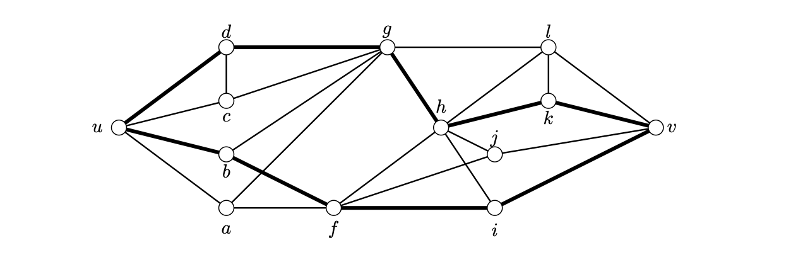

> [!def] [Definition 47 (Vertex Separators and Independent Paths)](Definition%2047%20%28Vertex%20Separators%20and%20Independent%20Paths%29.md): For distinct vertices $u,v$, an **internal $uv$-cut** is a set $S\subseteq V(D)\setminus\{u,v\}$ such that $D-S$ has no $u$–$v$ path. A family of $u$–$v$ paths is **independent** if any two have disjoint sets of internal vertices.

###### Examples.
> [!eg] Ex. 1: The cut $\{f,g\}$ separates $u$ from $v$. The two highlighted paths are independent, and no third independent path is possible since each must meet the cut at a different vertex.
> 

###### Dependencies.
- [Definition 43 (Vertex and Edge Connectivity)](Definition%2043%20%28Vertex%20and%20Edge%20Connectivity%29.md)
- [Definition 12 (Paths And Cycles)](../Chapter%201/Definition%2012%20%28Paths%20And%20Cycles%29.md)

###### References.
[1] Bickle, A. (2020). *Fundamentals of graph theory*. American Mathematical Society. (pp. 46 (63), 47 (64)). Source definition 2.36.

#mathematics #graph-theory #definition
