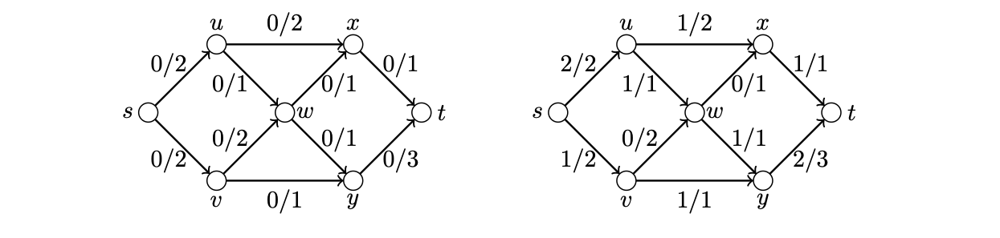

> [!def] [Definition 50 (Networks Flows and Cuts)](Definition%2050%20%28Networks%20Flows%20and%20Cuts%29.md): A **network** is a digraph with a nonnegative capacity $c(e)$ on each arc and distinguished vertices $s$ and $t$, called the **source** and **sink**. A **flow** is a function $f$ on the arcs satisfying  
> i. $0\leq f(e)\leq c(e)$ on every arc.  
> ii. Total inflow equals total outflow at each vertex other than $s$ and $t$.
>
> The **value** of a flow is the net flow out of $s$. A **source–sink cut** consists of the arcs from $S$ to $T$ for a vertex partition with $s\in S$ and $t\in T$. Its **capacity** is the sum of their capacities.

###### Motivation.
For a pipe network, each arc represents a one-way pipe, and its capacity limits the amount it can carry per unit time. The maximum-flow problem asks how much can be transported from the source to the sink.

###### Examples.
> [!eg] Ex. 1: The illustrated flow has value $3$. The cut $\{vy,wy,xt\}$ has capacity $3$.
> 

###### Dependencies.
- [Definition 49 (Edge Separators and Independent Paths)](Definition%2049%20%28Edge%20Separators%20and%20Independent%20Paths%29.md)

###### References.
[1] Bickle, A. (2020). *Fundamentals of graph theory*. American Mathematical Society. (pp. 51 (68), 52 (69)). Source definition 2.48.

#mathematics #graph-theory #definition
