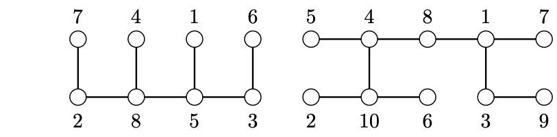

> [!ex] [Exercise 22 (Encoding a Labeled Tree)](Exercise%2022%20%28Encoding%20a%20Labeled%20Tree%29.md): Find the Prufer code of the tree above right.

###### Dependencies.
- [Theorem 07 (Cayley’s Formula)](../Theorem%2007%20%28Cayley%E2%80%99s%20Formula%29.md)

###### References.
[1] Bickle, A. (2020). *Fundamentals of graph theory*. American Mathematical Society. (p. 55 (72)). Section 2.1, Exercise 40.

#mathematics #graph-theory #exercise
