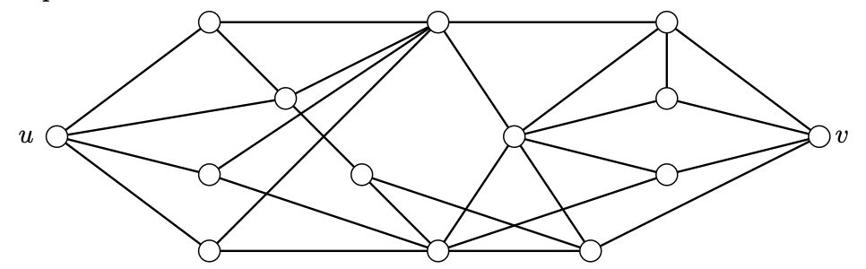

> [!ex] [Exercise 30 (Minimum Edge Cut Between Vertices)](Exercise%2030%20%28Minimum%20Edge%20Cut%20Between%20Vertices%29.md): In the graph above, find a minimum $uv$-edge cut and the same number of edge independent paths.

###### Dependencies.
- [Definition 49 (Edge Separators and Independent Paths)](../Definition%2049%20%28Edge%20Separators%20and%20Independent%20Paths%29.md)
- [Theorem 16 (Menger’s Edge Theorem)](../Theorem%2016%20%28Menger%E2%80%99s%20Edge%20Theorem%29.md)
- [Theorem 17 (Global Forms of Menger’s Theorem)](../Theorem%2017%20%28Global%20Forms%20of%20Menger%E2%80%99s%20Theorem%29.md)

###### References.
[1] Bickle, A. (2020). *Fundamentals of graph theory*. American Mathematical Society. (p. 60 (77)). Section 2.4, Exercise 14.

#mathematics #graph-theory #exercise
