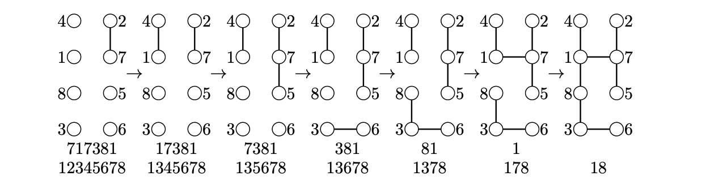
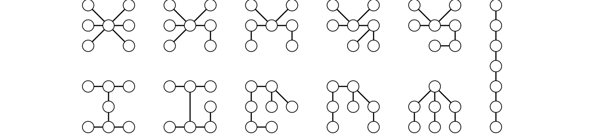

> [!thm] [Theorem 07 (Cayley’s Formula)](Theorem%2007%20%28Cayley%E2%80%99s%20Formula%29.md): The number of labeled trees on $[n]$ is $n^{n-2}$.

> [!rem] Remark. **Prüfer encoding.** Repeatedly delete the least-labeled current leaf and record its neighbor until two vertices remain. The resulting sequence has length $n-2$ and entries in $[n]$.

> [!rem] Remark. **Prüfer decoding.** Start with the unused labels $L=[n]$ and the full code. Join the smallest label in $L$ missing from the current code to the code's first entry. Delete the chosen label from $L$ and delete the first entry of the code. When the code is empty, join the last two unused labels.

> [!rem] Remark. If $t_{n}$ counts unlabeled trees, then $t_{n}n!\geq n^{n-2}$. Stirling's approximation gives $n^{n-2}/n!\sim e^{n}/(\sqrt{2\pi}n^{5/2})$. The sequence starts $1,1,1,2,3,6,11,23,47,106,235,\ldots$. Otter's asymptotic is $t_{n}\sim C\alpha^{n}/n^{5/2}$ with $C\approx0.534949606$ and $\alpha\approx2.95576528565$.

###### Examples.
> [!eg] Ex. 1: The tree with edges $27,41,57,63,38,71,18$ has code $(7,1,7,3,8,1)$. Encoding deletes the leaves $2,4,5,6,3,7$ in that order. Decoding inserts the same six edges and finally joins $1$ to $8$.
> 

> [!eg] Ex. 2: There are eleven unlabeled trees on seven vertices. The counts by maximum degree $6,5,4,3,2$ are $1,1,3,5,1$. For maximum degree $4$, add the two extra vertices to two distinct leaves of the star, as two leaves adjacent to a single old leaf, or as a two-edge extension of one leaf. For maximum degree $3$ with two such vertices, the unique degree-$2$ vertex either separates them or lies on a pendant path. With only one degree-$3$ vertex, the three branch lengths are $(1,1,4)$, $(1,2,3)$, or $(2,2,2)$.
> 

###### Proof.
> [!pf] *Proof.* For $n=1$ there is one tree. For $n\geq 2$, during encoding each vertex is recorded once for each incident edge lost before it becomes a leaf, hence exactly its degree minus one times. Thus labels absent from the code are exactly the initial leaves, and the first code entry identifies the neighbor of the least leaf. Delete that leaf and apply the same argument to the remaining tree and code. Decoding therefore recovers every encoded tree. There are $n^{n-2}$ possible words, and decoding any such word produces a tree by reversing leaf deletions. At each reverse step, the vertices absent from the remaining word are the current leaves, so encoding recovers the word. The two operations are inverse. $\blacksquare$

###### Dependencies.
- [Proposition 06 (Trees Have Two Leaves)](Proposition%2006%20%28Trees%20Have%20Two%20Leaves%29.md)
- [Theorem 05 (Constructing Trees)](Theorem%2005%20%28Constructing%20Trees%29.md)

###### References.
[1] Bickle, A. (2020). *Fundamentals of graph theory*. American Mathematical Society. (pp. 37 (54), 38 (55), 39 (56)). Source theorem 2.11 and Algorithms 2.9–2.10.

#mathematics #graph-theory #theorem
