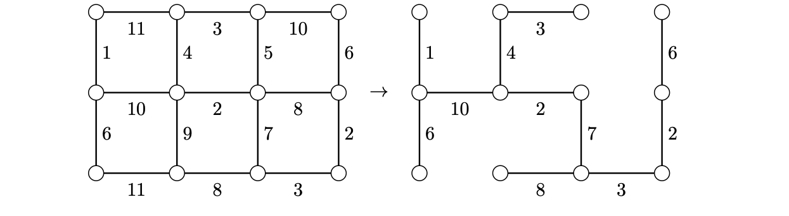

> [!thm] [Theorem 08 (Kruskal’s Algorithm)](Theorem%2008%20%28Kruskal%E2%80%99s%20Algorithm%29.md): Kruskal’s algorithm produces a minimum spanning tree of every connected weighted graph.

> [!rem] Remark. Start with the spanning graph with no edges. Repeatedly add a cheapest edge that creates no cycle, stopping when the graph becomes connected. This is a greedy algorithm because each choice minimizes the immediate cost.

> [!rem] Remark. Prim's algorithm starts with one vertex and repeatedly adds a cheapest edge from the current tree to a new vertex. The source compares the running times of the two methods when edges are presorted.

###### Examples.
> [!eg] Ex. 1: The illustrated run accepts edge weights $1,2,2,3,3,4,6,6,7,8$ and rejects the edge of weight $5$ and the other edge of weight $8$ because each closes a cycle at its turn.
> 

###### Proof.
> [!pf] *Proof.* The chosen edges form a spanning tree $T$, since whenever the forest is disconnected, some edge of the connected input joins two of its components. Take a minimum spanning tree $T'$ that agrees with the largest possible initial segment of the chosen edges. If the first disagreement is an edge $e$, then $T'+e$ contains a unique cycle. Some edge $e'$ of that cycle is outside $T$. At the step when $e$ was chosen, $e'$ was eligible because the preceding edges and $e'$ lie in $T'$. Hence $w(e)\leq w(e')$. Replacing $e'$ by $e$ in $T'$ gives a minimum spanning tree agreeing with a longer initial segment, a contradiction. $\blacksquare$

###### Dependencies.
- [Proposition 07 (Unique Paths in Trees)](Proposition%2007%20%28Unique%20Paths%20in%20Trees%29.md)
- [Definition 37 (Spanning Trees and Unicyclic Graphs)](Definition%2037%20%28Spanning%20Trees%20and%20Unicyclic%20Graphs%29.md)
- [Definition 38 (Weighted Graphs and Minimum Trees)](Definition%2038%20%28Weighted%20Graphs%20and%20Minimum%20Trees%29.md)

###### References.
[1] Bickle, A. (2020). *Fundamentals of graph theory*. American Mathematical Society. (pp. 40 (57), 41 (58)). Source theorem 2.17 and Algorithm 2.16.

#mathematics #graph-theory #theorem
