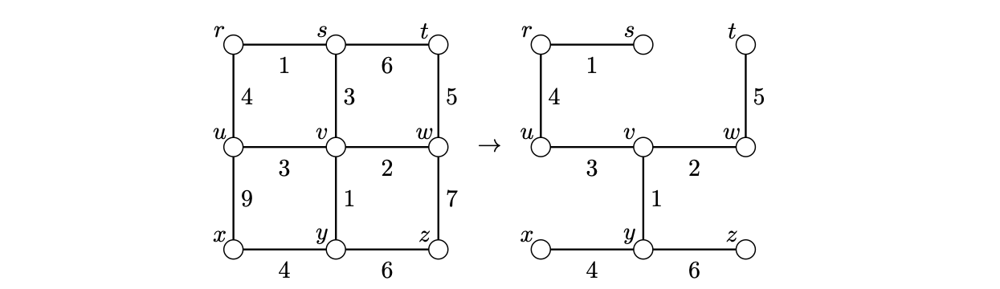

> [!thm] [Theorem 09 (Dijkstra’s Algorithm)](Theorem%2009%20%28Dijkstra%E2%80%99s%20Algorithm%29.md): For a weighted graph with nonnegative edge weights and starting vertex $u$, Dijkstra’s algorithm computes $d(u,z)$ for every vertex $z$.

> [!rem] Remark. Initially take $S=\{u\}$, $t(u)=0$, and $t(x)=w(ux)$ for neighbors of $u$, with $t(x)=\infty$ otherwise. Select a vertex $v\notin S$ of smallest finite tentative distance, add it to $S$, and for each neighbor $y\notin S$ replace $t(y)$ by $\min\{t(y),t(v)+w(vy)\}$. Stop when no finite tentative distance remains outside $S$.

> [!rem] Remark. The implementation described in the source takes $O(n^{2})$ time. With all weights $1$, the selection proceeds by distance layers as in breadth-first search. Running breadth-first search from every vertex computes all eccentricities and the diameter. In a connected graph, recording one predecessor per newly reached vertex yields a shortest-path spanning tree rooted at $u$.

###### Examples.
> [!eg] Ex. 1: The vertices $v,r,y,s,w,x,t,z$ are reached at distances $3,4,4,5,5,8,10,10$, respectively. The shortest-path tree uses $ur$ although replacing $ur$ with $vs$ reduces its total weight.
> 

###### Proof.
> [!pf] *Proof.* Induct on the number of settled vertices, starting with $d(u,u)=0$. Before settling $v$, each finite $t(x)$ is the length of a path from $u$ to $x$ through settled vertices. If a shorter path to $v$ existed, let $x$ be its first unsettled vertex and $y$ its predecessor. Settling $y$ made $t(x)$ at most the length of the prefix to $x$. Nonnegative weights make this prefix no longer than the full path, so $t(x)<t(v)$, contradicting the choice of $v$. If a reachable vertex remained unsettled at termination, a path to it would similarly have a first unsettled vertex with finite tentative distance. $\blacksquare$

###### Dependencies.
- [Definition 37 (Spanning Trees and Unicyclic Graphs)](Definition%2037%20%28Spanning%20Trees%20and%20Unicyclic%20Graphs%29.md)
- [Definition 39 (Weighted Distance)](Definition%2039%20%28Weighted%20Distance%29.md)
- [Definition 32 (Distance, Geodesic, Diameter, Radius, Eccentricity and Center)](../Chapter%201/Definition%2032%20%28Distance%2C%20Geodesic%2C%20Diameter%2C%20Radius%2C%20Eccentricity%20and%20Center%29.md)

###### References.
[1] Bickle, A. (2020). *Fundamentals of graph theory*. American Mathematical Society. (pp. 41 (58), 42 (59)). Source theorem 2.20 and Algorithm 2.19.

#mathematics #graph-theory #theorem
