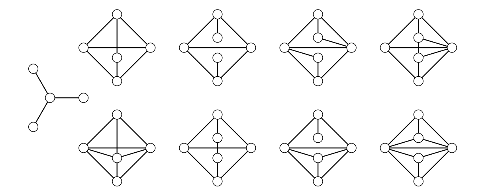

> [!thm] [Theorem 15 (Beineke’s Line Graph Characterization)](Theorem%2015%20%28Beineke%E2%80%99s%20Line%20Graph%20Characterization%29.md): A graph is the line graph of a simple graph if and only if it has none of the following nine induced subgraphs.
>
> 

###### Dependencies.
- [Definition 48 (Line Graphs and Digraphs)](Definition%2048%20%28Line%20Graphs%20and%20Digraphs%29.md)
- [Theorem 14 (Krausz’s Line Graph Characterization)](Theorem%2014%20%28Krausz%E2%80%99s%20Line%20Graph%20Characterization%29.md)
- [Definition 14 (Subgraphs And Induced Subgraphs)](../Chapter%201/Definition%2014%20%28Subgraphs%20And%20Induced%20Subgraphs%29.md)

###### References.
[1] Bickle, A. (2020). *Fundamentals of graph theory*. American Mathematical Society. (p. 49 (66)). Source theorem 2.40.

#mathematics #graph-theory #theorem
