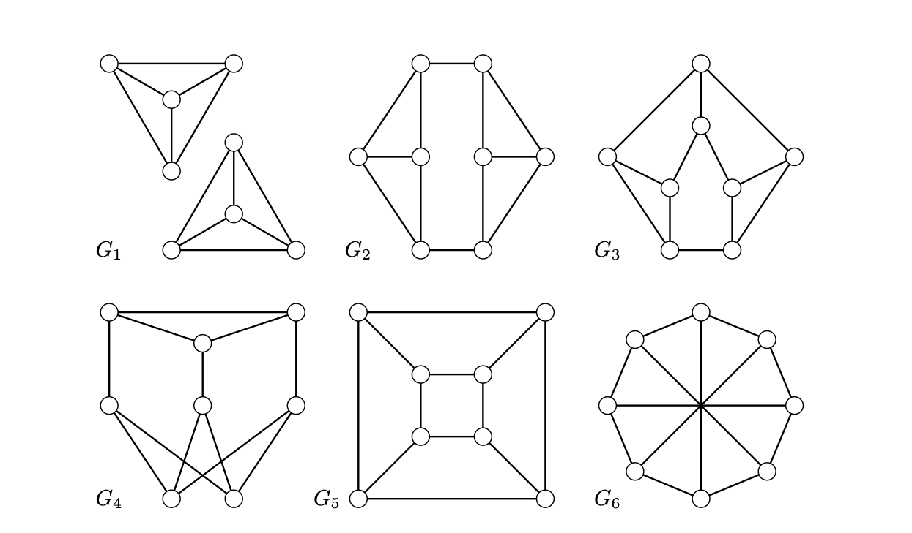

> [!def] [Definition 53 (Graph Invariants)](Definition%2053%20%28Graph%20Invariants%29.md): A **graph invariant** is a property or quantity preserved by isomorphism.

> [!rem] Remark. Examples include order, size, degree sequence, maximum and minimum degree, number of components, diameter, radius, bipartiteness, girth, and the two connectivities. The presence of edge crossings and face lengths in a particular drawing can vary between drawings of the same graph.

###### Motivation.
If the degree sequences agree, the induced graphs on selected degree classes can supply more invariants. For regular graphs, compare the sorted rows of adjacency-matrix powers. The entries of the square count walks of length two, as shown in [Theorem 2 (Counting Walks By Matrix Powers)](../Chapter%201/Theorem%202%20%28Counting%20Walks%20By%20Matrix%20Powers%29.md). Higher powers can distinguish additional pairs.

###### Examples.
> [!eg] Ex. 1: Three graphs of order $6$ and size $9$ can be distinguished by their degrees. The first has degree sequence $(4,4,3,3,2,2)$, and the other two have $(4,3,3,3,3,2)$. In one of those two graphs the vertices of degrees $4$ and $2$ are adjacent, while in the other they are not.
> 

> [!eg] Ex. 2: Two plane drawings of one graph have face lengths $(3,3,4,6)$ and $(3,3,5,5)$, respectively.
> 

> [!eg] Ex. 3: The cubic graphs $K_{3,3}$ and $K_{3}\mathbin{\square}K_{2}$ have constant sorted rows $(3,3,3,0,0,0)$ and $(3,2,2,1,1,0)$, respectively, in their squared adjacency matrices.

> [!eg] Ex. 4: The six cubic graphs of order eight are found by classifying cuts and short cycles. The disconnected graph is $2K_{4}$. A minimum cut of two edges splits the connected example into two copies of $K_{4}-e$. For the remaining graphs, a cut of three independent edges leaves a triangle and either a $5$-cycle with a chord or $K_{2,3}$. A triangle would have led to one of these cut cases. In the triangle-free bipartite case each part has four vertices, and the missing cross edges form a perfect matching, giving $Q_{3}$. In the triangle-free nonbipartite case a shortest odd cycle has length five, and the other three vertices induce $P_{3}$. Avoiding triangles forces the remaining adjacencies, yielding the Möbius ladder. An odd cycle of length seven would have a vertex outside it adjacent to three cycle vertices, giving a shorter odd cycle.
> 

###### Dependencies.
- [Definition 43 (Vertex and Edge Connectivity)](../Chapter%202/Definition%2043%20%28Vertex%20and%20Edge%20Connectivity%29.md)
- [Theorem 11 (Connectivity of Cubic Graphs)](../Chapter%202/Theorem%2011%20%28Connectivity%20of%20Cubic%20Graphs%29.md)
- [Definition 52 (Graph Isomorphisms)](Definition%2052%20%28Graph%20Isomorphisms%29.md)
- [Definition 10 (Degree Sequence And Regularity)](../Chapter%201/Definition%2010%20%28Degree%20Sequence%20And%20Regularity%29.md)
- [Definition 14 (Subgraphs And Induced Subgraphs)](../Chapter%201/Definition%2014%20%28Subgraphs%20And%20Induced%20Subgraphs%29.md)
- [Definition 28 (Hypercube)](../Chapter%201/Definition%2028%20%28Hypercube%29.md)
- [Theorem 2 (Counting Walks By Matrix Powers)](../Chapter%201/Theorem%202%20%28Counting%20Walks%20By%20Matrix%20Powers%29.md)

###### References.
[1] Bickle, A. (2020). *Fundamentals of graph theory*. American Mathematical Society. (pp. 67 (84), 68 (85), 69 (86), 70 (87), 71 (88), 72 (89)). Source definition 3.7.

#mathematics #graph-theory #definition
