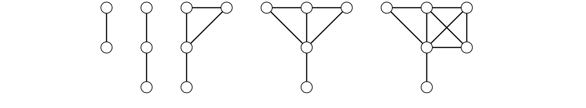

> [!def] [Definition 61 (Irregular Graphs)](Definition%2061%20%28Irregular%20Graphs%29.md): For $n\geq2$, the **irregular graph** $I_{n}$ is the unique connected graph of order $n$ with degrees $1,\ldots,n-1$ and $\lfloor n/2\rfloor$ repeated.

> [!rem] Remark. The proof of [Proposition 17 (Irregular Graph Uniqueness)](Proposition%2017%20%28Irregular%20Graph%20Uniqueness%29.md) gives $I_{n}=(I_{n-2}\cup K_{1})+K_{1}$ for $n\geq4$, starting from $I_{2}=K_{2}$ and $I_{3}=P_{3}$.

###### Examples.
> [!eg] Ex. 1: The figure shows small irregular graphs.
> 

###### Dependencies.
- [Proposition 17 (Irregular Graph Uniqueness)](Proposition%2017%20%28Irregular%20Graph%20Uniqueness%29.md)
- [Definition 23 (Union And Disjoint Union)](../Chapter%201/Definition%2023%20%28Union%20And%20Disjoint%20Union%29.md)
- [Definition 24 (Join And Wheel)](../Chapter%201/Definition%2024%20%28Join%20And%20Wheel%29.md)

###### References.
[1] Bickle, A. (2020). *Fundamentals of graph theory*. American Mathematical Society. (p. 78 (95)). Source definition 3.25.

#mathematics #graph-theory #definition
