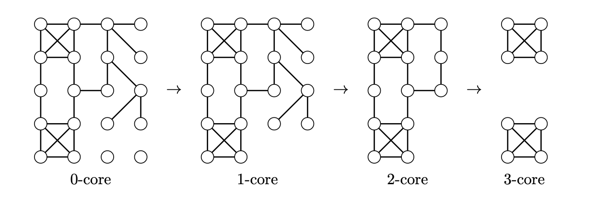

> [!def] [Definition 62 (Cores and Core Numbers)](Definition%2062%20%28Cores%20and%20Core%20Numbers%29.md): The **$k$-core** $C_{k}(G)$ is the maximal induced subgraph $H$ with $\delta(H)\geq k$, when one exists. A graph with minimum degree at least $k$ is itself a $k$-core. A **$k$-core-free** graph contains no $k$-core. The **core number** of a vertex is the largest $k$ for which it belongs to $C_{k}(G)$, and the **maximum core** is induced by vertices of largest core number.

> [!rem] Remark. The union of vertex sets inducing minimum degree at least $k$ still induces minimum degree at least $k$. Hence the maximal core is unique. The cores are nested, with $C_{k}(G)\subseteq C_{j}(G)$ for $k>j$.

###### Motivation.
A core models a subgroup of a social network in which every member has at least a specified number of acquaintances inside the group. The source traces cores to Seidman and mentions applications to network visualization and bioinformatics.

###### Examples.
> [!eg] Ex. 1: The illustrated graph is its own $0$-core. The figure shows its nested $1$-, $2$-, and $3$-cores.
> 

###### Dependencies.
- [Definition 10 (Degree Sequence And Regularity)](../Chapter%201/Definition%2010%20%28Degree%20Sequence%20And%20Regularity%29.md)
- [Definition 14 (Subgraphs And Induced Subgraphs)](../Chapter%201/Definition%2014%20%28Subgraphs%20And%20Induced%20Subgraphs%29.md)
- [Definition 17 (Maximal And Maximum Structures)](../Chapter%201/Definition%2017%20%28Maximal%20And%20Maximum%20Structures%29.md)

###### References.
[1] Bickle, A. (2020). *Fundamentals of graph theory*. American Mathematical Society. (pp. 78 (95), 79 (96)). Source definition 3.26.

#mathematics #graph-theory #definition
