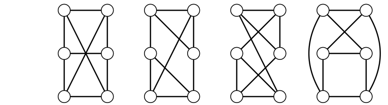

> [!ex] [Exercise 40 (Isomorphism Among Six-Vertex Graphs)](Exercise%2040%20%28Isomorphism%20Among%20Six-Vertex%20Graphs%29.md): Determine which pairs of graphs below are isomorphic.
>
> 

**What to show.** Show that $G_1\cong G_4$ and $G_2\cong G_3$ for the drawings numbered left to right, and use the component structure of the complements to rule out every other pair.

###### Solution.
> [!sol] *Solution.* Number the graphs $G_1,G_2,G_3,G_4$ from left to right. In each graph label its vertices $a,b$ on the top row, $c,d$ on the middle row, and $e,f$ on the bottom row, going left to right. Each graph is $3$-regular, so its complement is $2$-regular. Reading the nonedges gives the following cycles of the complements, with the last vertex of each cycle joined back to the first.
>
> | Graph | Cycles of its complement |
> | --- | --- |
> | $G_1$ | $(a,d,e)$ and $(b,c,f)$ |
> | $G_2$ | $(a,e,d,c,b,f)$ |
> | $G_3$ | $(a,c,d,f,b,e)$ |
> | $G_4$ | $(a,c,f)$ and $(b,d,e)$ |
>
> Matching cycles of equal length gives isomorphisms of the complements, which are also isomorphisms of the original graphs by [Proposition 13 (Isomorphism of Complements)](../Proposition%2013%20%28Isomorphism%20of%20Complements%29.md). Since the complement types $C_6$ and $C_3\cup C_3$ have different component counts, the only isomorphic pairs are $G_1\cong G_4$ and $G_2\cong G_3$. $\blacksquare$

###### Dependencies.
- [Proposition 13 (Isomorphism of Complements)](../Proposition%2013%20%28Isomorphism%20of%20Complements%29.md)
- [Definition 52 (Graph Isomorphisms)](../Definition%2052%20%28Graph%20Isomorphisms%29.md)
- [Definition 53 (Graph Invariants)](../Definition%2053%20%28Graph%20Invariants%29.md)

###### References.
[1] Bickle, A. (2020). *Fundamentals of graph theory*. American Mathematical Society. (p. 90 (107)). Section 3.2, Exercise 8.

#mathematics #graph-theory #exercise
