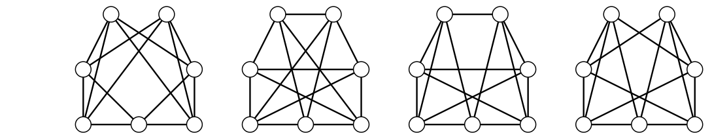

> [!ex] [Exercise 41 (Isomorphism Among Seven-Vertex Graphs)](Exercise%2041%20%28Isomorphism%20Among%20Seven-Vertex%20Graphs%29.md): Determine which pairs of graphs below are isomorphic.
>
> 

**What to show.** Verify the two isomorphic pairs by matching the cycles in their complements, and distinguish graphs whose complements have different component counts.

###### Solution.
> [!sol] *Solution.* Number the graphs $G_1,G_2,G_3,G_4$ from left to right. In each graph use labels $a,b$ on the top row, $c,d$ on the middle row, and $e,f,g$ on the bottom row, going left to right. All four graphs are $4$-regular, so each complement is $2$-regular. Reading the nonedges gives the following cycles of the complements.
>
> | Graph | Cycles of its complement |
> | --- | --- |
> | $G_1$ | $(a,b,f)$ and $(c,d,e,g)$ |
> | $G_2$ | $(a,d,f,c,b,g,e)$ |
> | $G_3$ | $(a,d,f,c,b,e,g)$ |
> | $G_4$ | $(a,b,e,g)$ and $(c,d,f)$ |
>
> Matching vertices in cyclic order in the components of equal length gives isomorphisms of the complements and hence of the original graphs, by [Proposition 13 (Isomorphism of Complements)](../Proposition%2013%20%28Isomorphism%20of%20Complements%29.md). The two complement types $C_7$ and $C_3\cup C_4$ have different component counts, so the only isomorphic pairs are $G_1\cong G_4$ and $G_2\cong G_3$. $\blacksquare$

###### Dependencies.
- [Proposition 13 (Isomorphism of Complements)](../Proposition%2013%20%28Isomorphism%20of%20Complements%29.md)
- [Definition 52 (Graph Isomorphisms)](../Definition%2052%20%28Graph%20Isomorphisms%29.md)
- [Definition 53 (Graph Invariants)](../Definition%2053%20%28Graph%20Invariants%29.md)

###### References.
[1] Bickle, A. (2020). *Fundamentals of graph theory*. American Mathematical Society. (p. 90 (107)). Section 3.2, Exercise 9.

#mathematics #graph-theory #exercise
