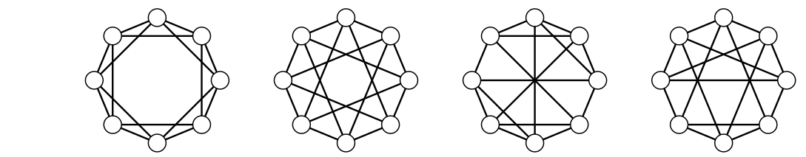

> [!ex] [Exercise 42 (Isomorphism Among Eight-Vertex Graphs)](Exercise%2042%20%28Isomorphism%20Among%20Eight-Vertex%20Graphs%29.md): Determine which pairs of graphs below are isomorphic.
>
> 

**What to show.** Give an explicit isomorphism between the third and fourth graphs, and use triangle counts to rule out the other pairs.

###### Solution.
> [!sol] *Solution.* Number the graphs $G_1,G_2,G_3,G_4$ from left to right. In each graph label its vertices $0,\ldots,7$ clockwise from the top vertex. The only isomorphic pair is $G_3\cong G_4$. An isomorphism sends $(0,1,2,3,4,5,6,7)$ in $G_3$ to $(2,6,1,0,3,5,4,7)$ in $G_4$. Applying this bijection to the eight rim edges and the eight chords of $G_3$ gives the sixteen edges of $G_4$.
>
> To exclude the other pairs, use triangle counts. In $G_1$, the eight triangles are the triples of consecutive rim vertices. These are the only triangles because its chords join vertices with exactly one rim vertex between them, and the chord subgraph is a pair of $4$-cycles. Every edge of $G_2$ joins vertices of opposite parity, so $G_2$ has no triangles. The triangles of $G_3$ are $(0,1,2)$, $(0,1,7)$, $(3,4,5)$, and $(4,5,6)$, found by checking the neighbors of each vertex. Thus the triangle counts of the three types are $8,0,4$. $\blacksquare$

###### Dependencies.
- [Definition 52 (Graph Isomorphisms)](../Definition%2052%20%28Graph%20Isomorphisms%29.md)
- [Definition 53 (Graph Invariants)](../Definition%2053%20%28Graph%20Invariants%29.md)

###### References.
[1] Bickle, A. (2020). *Fundamentals of graph theory*. American Mathematical Society. (p. 90 (107)). Section 3.2, Exercise 10.

#mathematics #graph-theory #exercise
