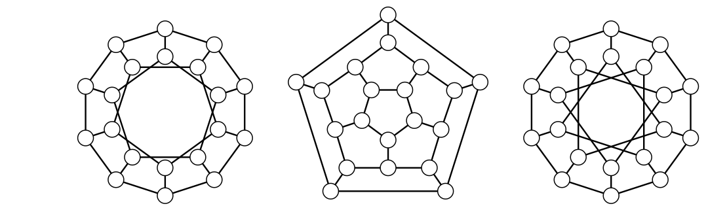

> [!ex] [Exercise 43 (Isomorphism Among Larger Graphs)](Exercise%2043%20%28Isomorphism%20Among%20Larger%20Graphs%29.md): Determine which pairs of graphs below are isomorphic.
>
> 

###### Dependencies.
- [Definition 52 (Graph Isomorphisms)](../Definition%2052%20%28Graph%20Isomorphisms%29.md)
- [Definition 53 (Graph Invariants)](../Definition%2053%20%28Graph%20Invariants%29.md)

###### References.
[1] Bickle, A. (2020). *Fundamentals of graph theory*. American Mathematical Society. (p. 90 (107)). Section 3.2, Exercise 11.

#mathematics #graph-theory #exercise
