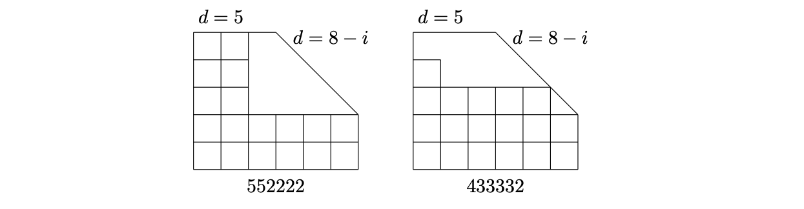

> [!lem] [Lemma 08 (Terms Attaining the Degree Bound)](Lemma%2008%20%28Terms%20Attaining%20the%20Degree%20Bound%29.md): Let $0\leq k\leq n-1$ and let $d_{1}\geq\cdots\geq d_{n}$ be integers with $k\leq d_{i}\leq\min\{n-1,k+n-i\}$ and $\sum_{i=1}^{n}d_{i}=2[kn-\binom{k+1}{2}]$. At most $k+1$ terms attain their upper bounds.

###### Examples.
> [!eg] Ex. 1: For $n=6$ and $k=2$, the figure displays column diagrams for $(5,5,2,2,2,2)$ and $(4,3,3,3,3,2)$.
> 

###### Proof.
> [!pf] *Proof.* The source represents $d_{i}$ as the height of column $i$. If all columns attaining the upper bound are at the ends, the sum bound allows at most $k$ initial columns in addition to the last column. An initial group of $k$ already consumes the full allowance above the baseline $k$. The source then sketches a box-moving argument for the remaining case, choosing a counterexample with as many saturated columns at the ends as possible and moving boxes from a saturated middle column to extend an end group. The precise move and its preservation of all bounds are {unresolved}. $\blacksquare$

###### Dependencies.
- [Lemma 07 (Degree Bounds by Rank)](Lemma%2007%20%28Degree%20Bounds%20by%20Rank%29.md)

###### References.
[1] Bickle, A. (2020). *Fundamentals of graph theory*. American Mathematical Society. (pp. 83 (100), 84 (101)). Source lemma 3.40.

#mathematics #graph-theory #lemma
