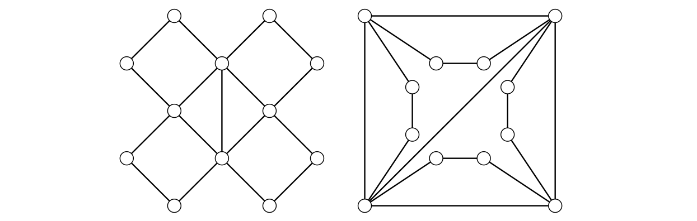

> [!prop] [Proposition 14 (Subgraph Counts Are Invariant)](Proposition%2014%20%28Subgraph%20Counts%20Are%20Invariant%29.md): For any fixed graph $F$, the number of subgraphs isomorphic to $F$ is an isomorphism invariant. In particular, the existence of such a subgraph is invariant.

###### Examples.
> [!eg] Ex. 1: The two graphs considered in the source each have a unique copy of $K_{4}-e$. Their degree-$5$ vertices induce $K_{2}$, and their degree-$4$ and degree-$5$ vertices together induce $K_{4}-e$. The degree-$4$ and degree-$2$ vertices together induce $2P_{5}$. Matching the unique copy helps determine the isomorphism.
> 

###### Proof.
> [!pf] *Proof.* An isomorphism transports the vertices and edges of each copy of $F$ to a copy of $F$. Its inverse transports copies back, giving a bijection. $\blacksquare$

###### Dependencies.
- [Definition 52 (Graph Isomorphisms)](Definition%2052%20%28Graph%20Isomorphisms%29.md)
- [Definition 53 (Graph Invariants)](Definition%2053%20%28Graph%20Invariants%29.md)
- [Definition 14 (Subgraphs And Induced Subgraphs)](../Chapter%201/Definition%2014%20%28Subgraphs%20And%20Induced%20Subgraphs%29.md)

###### References.
[1] Bickle, A. (2020). *Fundamentals of graph theory*. American Mathematical Society. (p. 69 (86)). Source proposition 3.10.

#mathematics #graph-theory #proposition
