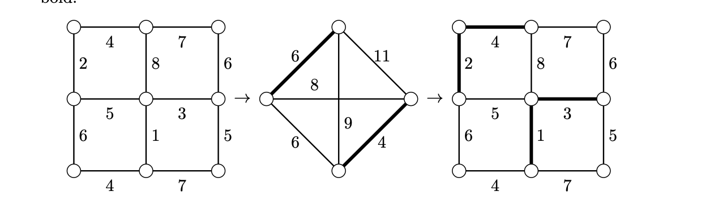

> [!thm] [Theorem 21 (Open Trail Decomposition)](Theorem%2021%20%28Open%20Trail%20Decomposition%29.md): A connected multigraph with exactly $2k>0$ odd-degree vertices requires a minimum of $k$ open trails to partition its edge set.

> [!rem] Remark. The case $k=1$ says that a connected multigraph admits an Eulerian trail exactly when there are two odd-degree vertices, which are its endpoints.

> [!rem] Remark. The **Chinese postman problem** asks for a minimum-weight closed walk using every edge of a connected weighted graph. In the even-degree case, an Eulerian circuit is optimal. Otherwise the extra traversals must connect the $2k$ odd vertices in pairs. Build a complete graph on those vertices with weights given by their shortest-path distances, compute a minimum-weight perfect matching, duplicate the edges of its corresponding paths, and take an Eulerian circuit of the result. The source attributes the $O(n^{3})$ solution to Edmonds and Johnson.

###### Examples.
> [!eg] Ex. 1: The Königsberg multigraph has four odd-degree vertices and decomposes into two open trails. A theta graph such as $K_{2,3}$ has exactly two odd-degree vertices and admits an Eulerian trail. The Petersen graph has ten odd-degree vertices and requires five open trails.

> [!eg] Ex. 2: For the illustrated Chinese postman instance, the three perfect matchings of the four odd vertices cost $8+9=17$, $6+11=17$, and $6+4=10$. The last matching identifies the paths to repeat.
> 

###### Proof.
> [!pf] *Proof.* Each open trail contributes odd degree at only its two endpoints, so at least $k$ are needed. Pair the $2k$ odd vertices and adjoin one edge per pair, obtaining a connected even-degree multigraph. By [Theorem 20 (Eulerian Multigraph Characterization)](Theorem%2020%20%28Eulerian%20Multigraph%20Characterization%29.md), it has an Eulerian circuit. Removing the $k$ added edges splits the circuit into $k$ trails. Since the added edges have distinct endpoints, no two added edges are consecutive in the circuit, and each resulting trail has distinct endpoints. $\blacksquare$

###### Dependencies.
- [Definition 38 (Weighted Graphs and Minimum Trees)](../Chapter%202/Definition%2038%20%28Weighted%20Graphs%20and%20Minimum%20Trees%29.md)
- [Theorem 09 (Dijkstra’s Algorithm)](../Chapter%202/Theorem%2009%20%28Dijkstra%E2%80%99s%20Algorithm%29.md)
- [Definition 51 (Trails Circuits and Eulerian Graphs)](Definition%2051%20%28Trails%20Circuits%20and%20Eulerian%20Graphs%29.md)
- [Theorem 20 (Eulerian Multigraph Characterization)](Theorem%2020%20%28Eulerian%20Multigraph%20Characterization%29.md)
- [Definition 34 (Bipartite Graphs And Matchings)](../Chapter%201/Definition%2034%20%28Bipartite%20Graphs%20And%20Matchings%29.md)

###### References.
[1] Bickle, A. (2020). *Fundamentals of graph theory*. American Mathematical Society. (pp. 65 (82), 66 (83)). Source theorem 3.4.

#mathematics #graph-theory #theorem
