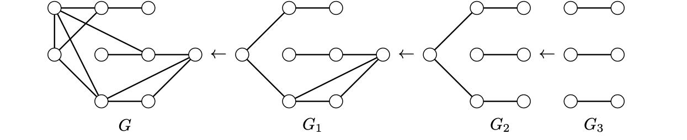

> [!thm] [Theorem 23 (Havel–Hakimi Theorem)](Theorem%2023%20%28Havel%E2%80%93Hakimi%20Theorem%29.md): Let $S=(d_{1},\ldots,d_{n})$ be a nonincreasing sequence of nonnegative integers with $0\leq d_{1}\leq n-1$. Then $S$ is graphic if and only if the sequence obtained by deleting $d_{1}$ and subtracting one from the next $d_{1}$ entries is graphic.

> [!rem] Remark. For recognition, repeatedly apply the reduction and reorder. An all-zero sequence is graphic. A negative entry or a largest term exceeding the number of other terms certifies failure.

> [!rem] Remark. To construct a realization, begin with a realization of the last reduced sequence, then reverse each reduction by adding a vertex adjacent to the vertices corresponding to the reduced entries. Ties can give different outcomes. Some realizations, such as $2P_{3}$, do not arise from this construction.

###### Examples.
> [!eg] Ex. 1: The reductions for $(8,8,7,6,6,4,4,3,2)$ pass through $(7,6,5,5,3,3,2,1)$, $(5,4,4,2,2,1,0)$, $(3,3,1,1,0,0)$, and $(2,0,0,0,0)$. The next reduction has negative terms.

> [!eg] Ex. 2: The sequence $(4,4,3,3,3,3,2,1,1)$ reduces to $(3,3,2,2,2,2,1,1)$, then $(2,2,2,1,1,1,1)$, then six ones, realized by $3K_{2}$. Reversing the construction first gives $P_{5}\cup K_{2}$ and then gives the two larger graphs in the figure.
> 

###### Proof.
> [!pf] *Proof.* ($\Leftarrow$) Add a vertex adjacent to the vertices corresponding to the terms that were decreased.
>
> ($\Rightarrow$) Let $v_{1}$ represent $d_{1}$ in a realization and let $W$ be the designated set of the $d_{1}$ largest remaining degrees. If $v_{1}$ misses $w\in W$, it has a neighbor $x\notin W$ with $d(w)\geq d(x)$. There is a vertex $y\notin\{v_{1},w,x\}$ adjacent to $w$ but not $x$. Indeed, after excluding the possible edge $wx$, the neighbor $v_{1}$ of $x$ has no counterpart at $w$. Replace $v_{1}x,wy$ by $v_{1}w,xy$. This preserves all degrees and increases the number of neighbors of $v_{1}$ in $W$. Repeat until $N(v_{1})=W$, then delete $v_{1}$. $\blacksquare$

###### Dependencies.
- [Definition 58 (Graphic Sequences and Realizations)](Definition%2058%20%28Graphic%20Sequences%20and%20Realizations%29.md)
- [Definition 9 (Degree And Neighborhood)](../Chapter%201/Definition%209%20%28Degree%20And%20Neighborhood%29.md)

###### References.
[1] Bickle, A. (2020). *Fundamentals of graph theory*. American Mathematical Society. (pp. 74 (91), 75 (92)). Source theorem 3.16 and Algorithms 3.17–3.18.

#mathematics #graph-theory #theorem
