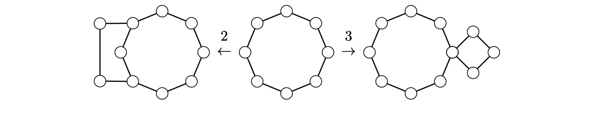

> [!thm] [Theorem 27 (Constructing Connected Two-Monocore Graphs)](Theorem%2027%20%28Constructing%20Connected%20Two-Monocore%20Graphs%29.md): The connected $2$-monocore graphs are precisely those obtained from cycles by repeating the following operations.
>
> (1) Adjoin a path of length at least two with new internal vertices, identifying its endpoints with distinct vertices of one existing graph or with one vertex in each of two existing graphs.  
> (2) Adjoin a cycle by identifying one of its vertices with a vertex of an existing graph, or by adding a single edge joining the new cycle to the existing graph.

###### Examples.
> [!eg] Ex. 1: The figure shows the path and cycle operations.
> 

###### Proof.
> [!pf] *Proof.* ($\Leftarrow$) A cycle has minimum degree two and is $3$-core-free. Each operation preserves minimum degree two. The new internal path vertices or the new degree-two cycle vertices cannot belong to a $3$-core, so the operation cannot create one. Apply [Corollary T26.01 (Degeneracy Equals Maximum Core Number)](Corollary%20T26.01%20%28Degeneracy%20Equals%20Maximum%20Core%20Number%29.md).
>
> ($\Rightarrow$) Induct on the order, taking cycles as the base. In a connected graph of minimum degree two that is not a cycle, follow a chain through degree-two vertices. Either it gives an ear between two distinct vertices of degree at least three, or it returns to one vertex $u$ to form a cycle all of whose other vertices have degree two. In the first case, remove the internal vertices of the ear. The remaining one or two components have minimum degree at least two and no $3$-core, so induction and operation (1) apply. In the second case, if $d(u)\geq4$, delete the other cycle vertices. If $d(u)=3$, its outside neighbor must have degree at least three, since an outside neighbor of degree two could be followed to make an ear. Delete the entire cycle. The remainder has minimum degree at least two and no $3$-core, so induction and operation (2) apply. $\blacksquare$

###### Dependencies.
- [Definition 36 (Operation Characterizations)](../Chapter%202/Definition%2036%20%28Operation%20Characterizations%29.md)
- [Corollary T26.01 (Degeneracy Equals Maximum Core Number)](Corollary%20T26.01%20%28Degeneracy%20Equals%20Maximum%20Core%20Number%29.md)
- [Definition 64 (Monocore Graphs)](Definition%2064%20%28Monocore%20Graphs%29.md)
- [Definition 65 (Ears)](Definition%2065%20%28Ears%29.md)

###### References.
[1] Bickle, A. (2020). *Fundamentals of graph theory*. American Mathematical Society. (pp. 81 (98), 82 (99)). Source theorem 3.34.

#mathematics #graph-theory #theorem
