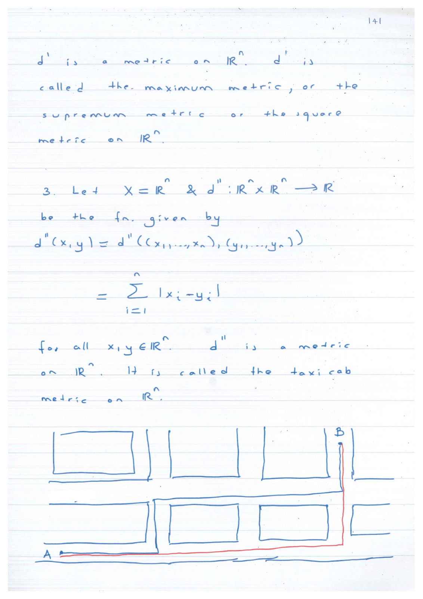

> [!def] [Definition 24 (Metric Space)](Definition%2024%20%28Metric%20Space%29.md): Let $X$ be nonempty and $d:X\times X\to\mathbb{R}$. The function $d$ is a **metric**, or **distance function**, if for all $x,y,z\in X$:  
> i. $d(x,y)\geq0$.  
> ii. $d(x,y)=d(y,x)$ (symmetry).  
> iii. $d(x,y)\leq d(x,z)+d(z,y)$ (triangle inequality).  
> iv. $d(x,y)=0$ if and only if $x=y$.  
> The pair $(X,d)$ is a **metric space**.
A metric $\rho$ on $Y$ is **bounded** if there is $M>0$ such that $\rho(x,y)\leq M$ for all $x,y\in Y$.

> [!rem] For $n>1$, the Euclidean, maximum, and taxicab metrics below are different metrics. 

###### Examples.
> [!eg] Ex. 1: On $\mathbb{R}^{n}$, $d(x,y)=\sqrt{\sum_{i=1}^{n}(x_i-y_i)^2}$ is the usual, or Euclidean, metric. For $n=1$, $d(x,y)=\sqrt{(x-y)^2}=|x-y|$. For $n=2$, $d((x_1,x_2),(y_1,y_2))=\sqrt{(x_1-y_1)^2+(x_2-y_2)^2}$.

> [!eg] Ex. 2: On $\mathbb{R}^{n}$, $d'(x,y)=\max_{1\leq i\leq n}|x_i-y_i|$ is the maximum, supremum, or square metric.

> [!eg] Ex. 3: On $\mathbb{R}^{n}$, $d''(x,y)=\sum_{i=1}^{n}|x_i-y_i|$ is the taxicab metric. 
>
> 

> [!eg] Ex. 4: On any nonempty set, $d(x,y)=0$ if $x=y$ and $d(x,y)=1$ if $x\ne y$ is the discrete, or trivial, metric.

> [!eg] Ex. 5: For any metric $d$ on $X$, $d'(x,y)=\min\{d(x,y),1\}$ is an equivalent bounded metric, since $d'(x,y)\leq1$. Thus every metric has an equivalent bounded metric. No verification is supplied.

###### Dependencies.
- [0-Preliminaries](0-Preliminaries.md)
- [Definition 26 (Metrizability and Equivalent Metrics)](Definition%2026%20%28Metrizability%20and%20Equivalent%20Metrics%29.md)

###### References.
[1] Talu (2026 Fall) *Lecture*.
[2] [420-Week 6-Lecture 2.pdf](_attachments/420-Week%206-Lecture%202.pdf) (pp. 138 (8)).
[3] [420-Week 6-Lecture 3.pdf](_attachments/420-Week%206-Lecture%203.pdf) (pp. 138 (1), 139 (2), 140 (3), 141 (4), 142 (5)).
[4] [420-Week 7-Lecture 1.pdf](_attachments/420-Week%207-Lecture%201.pdf) (pp. 160 (10)).
[5] [420-Week 7-Lecture 2.pdf](_attachments/420-Week%207-Lecture%202.pdf) (pp. 160 (1)).

#mathematics #point-set-topology #definition
