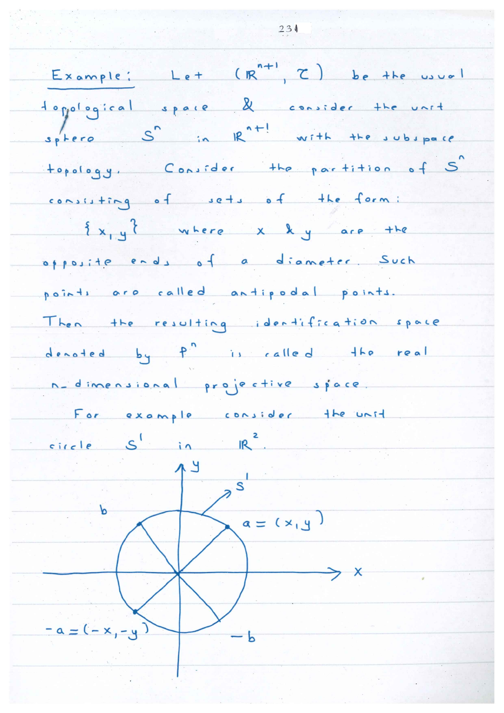
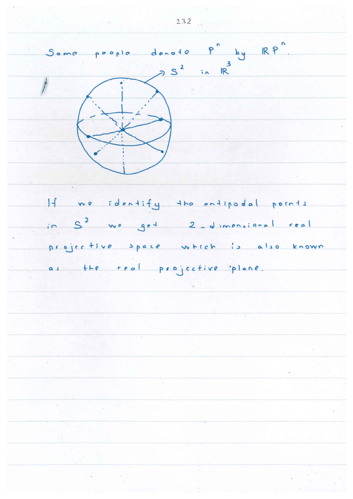
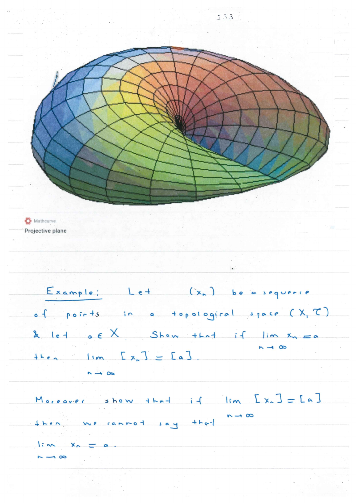

> [!def] [Definition 36 (Real Projective Space)](Definition%2036%20%28Real%20Projective%20Space%29.md): Give the unit sphere $S^n\subseteq\mathbb{R}^{n+1}$ its usual subspace topology. Two points that are opposite ends of a diameter are **antipodal points**. The identification space obtained from the partition into pairs of antipodal points is the **real $n$-dimensional projective space**, denoted $P^n$ or $\mathbb{R}P^n$.

###### Examples.
> [!eg] Ex. 1: For $S^1\subseteq\mathbb{R}^2$, $a=(x,y)$ and $-a=(-x,-y)$ are antipodal, and the supplied diagram also marks a second pair $b,-b$. 
>
> 

> [!eg] Ex. 2: Identifying antipodal points of $S^2\subseteq\mathbb{R}^3$ gives $P^2$, the **real projective plane**. The sphere diagram and the supplied Mathcurve illustration are: 
>
> 
>
>  
>
> 

###### Dependencies.
- [Definition 01 (Topological Space)](Definition%2001%20%28Topological%20Space%29.md)
- [Theorem 28 (Subspace Topology)](Theorem%2028%20%28Subspace%20Topology%29.md)
- [Definition 32 (Partitions)](Definition%2032%20%28Partitions%29.md)
- [Definition 34 (Quotient and Identification Topologies)](Definition%2034%20%28Quotient%20and%20Identification%20Topologies%29.md)
- [Theorem 39 (Equivalence Relations and Partitions)](Theorem%2039%20%28Equivalence%20Relations%20and%20Partitions%29.md)

###### References.
[1] Talu (2026 Fall) *Lecture*.
[2] [420-Week 9-Lecture 2.pdf](_attachments/420-Week%209-Lecture%202.pdf) (pp. 231 (9), 232 (10), 233 (11)).

#mathematics #point-set-topology #definition
