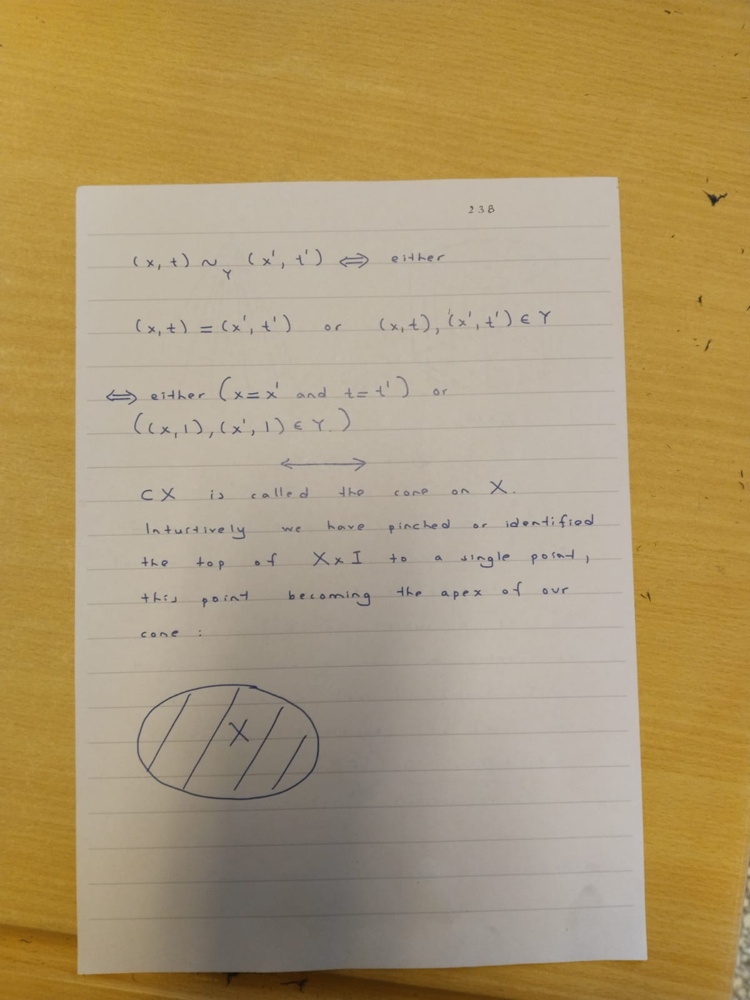
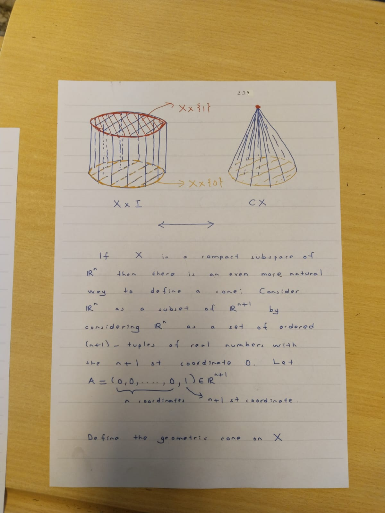
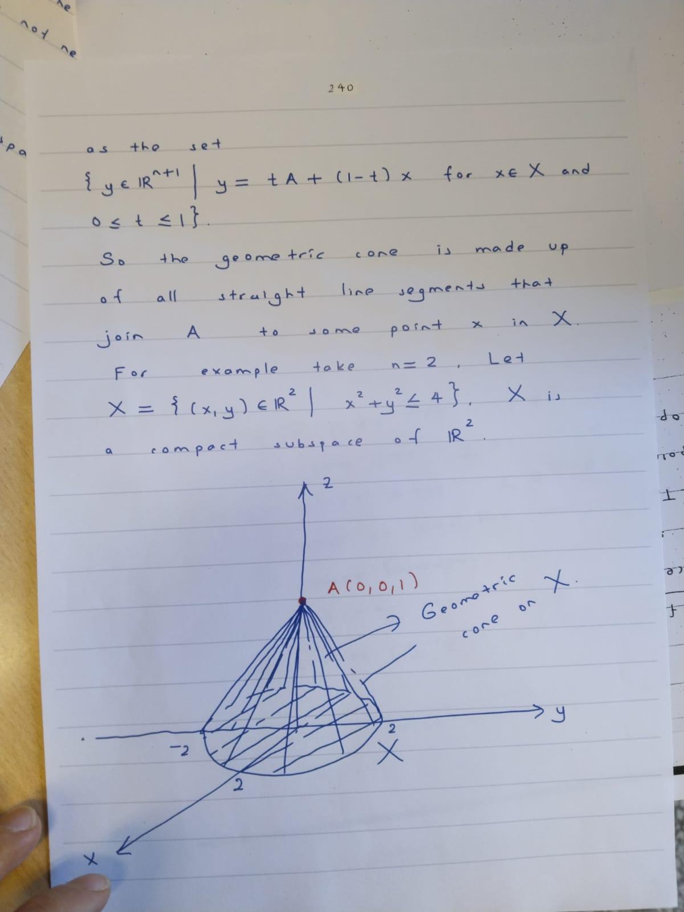

> [!def] [Definition 39 (Cones)](Definition%2039%20%28Cones%29.md): Let $(X,\mathcal{T})$ be a nonempty topological space and $I=[0,1]$. The **cone on $X$**, denoted $CX$, is the identification space for the partition of $X\times I$ into $X\times\{1\}$ and the singletons $\{(x,t)\}$ with $x\in X$ and $0\le t<1$. Thus $CX=(X\times I)/(X\times\{1\})$, where $(x,t)\sim(x',t')$ if and only if $(x=x'\text{ and }t=t')$ or $t=t'=1$. For a compact subspace $X\subseteq\mathbb{R}^n$, identify $\mathbb{R}^n$ with $\mathbb{R}^n\times\{0\}\subseteq\mathbb{R}^{n+1}$ and set $A=(0,\ldots,0,1)$. The **geometric cone on $X$** is $\{y\in\mathbb{R}^{n+1}\mid y=tA+(1-t)x,\ x\in X,\ 0\le t\le1\}$.

> [!rem] The displayed partition presumes a nonempty base $X$. In the last relation display on page 238, the clause involving $X\times\{1\}$ suppresses the required condition $t=t'=1$; that condition is written explicitly here.

###### Motivation.
The top $X\times\{1\}$ of $X\times I$ is *pinched to a single point*, which becomes the apex of the cone. The geometric cone is made of all straight line segments joining $A$ to points of $X$.

###### Examples.
> [!eg] Ex. 1: The supplied drawings show the base $X$, its product with the interval, and the top collapsed to the apex. 
>
> 
>
>  
>
> 

> [!eg] Ex. 2: For $n=2$, the compact disk $X=\{(x,y)\in\mathbb{R}^2\mid x^2+y^2\le4\}$ has the geometric cone illustrated with apex $A=(0,0,1)$. 
>
> 

###### Dependencies.
- [Definition 01 (Topological Space)](Definition%2001%20%28Topological%20Space%29.md)
- [Theorem 28 (Subspace Topology)](Theorem%2028%20%28Subspace%20Topology%29.md)
- [Theorem 33 (Product Topology)](Theorem%2033%20%28Product%20Topology%29.md)
- [Definition 32 (Partitions)](Definition%2032%20%28Partitions%29.md)
- [Definition 34 (Quotient and Identification Topologies)](Definition%2034%20%28Quotient%20and%20Identification%20Topologies%29.md)
- [Definition 37 (Collapsing a Subspace)](Definition%2037%20%28Collapsing%20a%20Subspace%29.md)
- Compactness {unresolved}

###### References.
[1] Talu (2026 Fall) *Lecture*.
[2] [420-Week 9-Lecture 3 photograph](_attachments/420-Week%209-Lecture%203/WhatsApp%20Image%202026-11-26%20at%2019.25.18%20%282%29.jpeg) (p. 237).
[3] [420-Week 9-Lecture 3 photograph](_attachments/420-Week%209-Lecture%203/WhatsApp%20Image%202026-11-26%20at%2019.25.18%20%281%29.jpeg) (p. 238).
[4] [420-Week 9-Lecture 3 photograph](_attachments/420-Week%209-Lecture%203/WhatsApp%20Image%202026-11-26%20at%2019.25.18.jpeg) (p. 239).
[5] [420-Week 9-Lecture 3 photograph](_attachments/420-Week%209-Lecture%203/WhatsApp%20Image%202026-11-26%20at%2019.25.15%20%283%29.jpeg) (p. 240).

#mathematics #point-set-topology #definition
