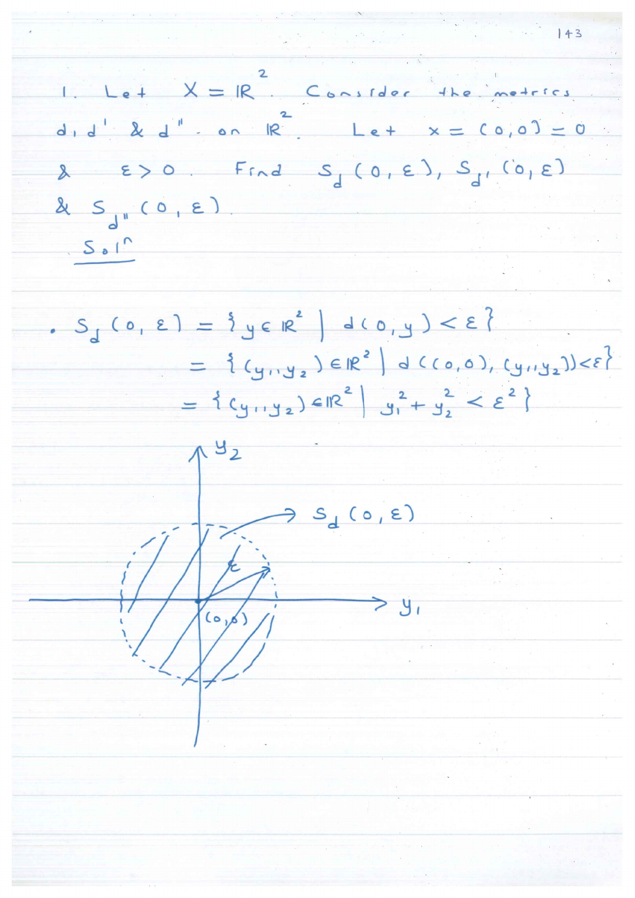
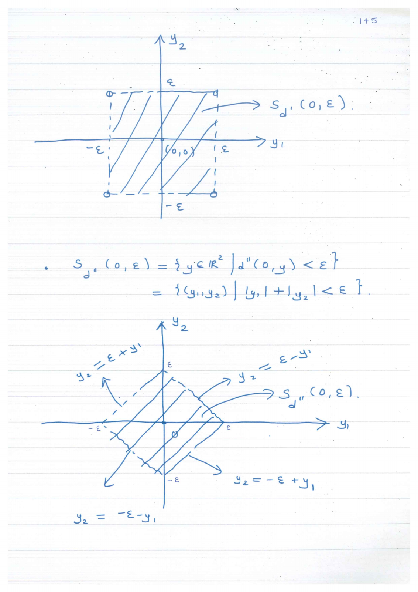

> [!ex] [Exercise 78 (Balls for Three Plane Metrics)](Exercise%2078%20%28Balls%20for%20Three%20Plane%20Metrics%29.md): Let $d,d',d''$ be the Euclidean, maximum, and taxicab metrics on $\mathbb{R}^{2}$, and let $\varepsilon>0$. Determine $S_d(0,\varepsilon)$, $S_{d'}(0,\varepsilon)$, and $S_{d''}(0,\varepsilon)$.

###### Solution.
> [!sol] *Solution.* For the Euclidean metric, $S_d(0,\varepsilon)=\{y\in\mathbb{R}^{2}\mid d(0,y)<\varepsilon\}=\{(y_1,y_2)\mid y_1^2+y_2^2<\varepsilon^2\}$, the open disc of radius $\varepsilon$. 
>
> 
>
>  For the maximum metric, $S_{d'}(0,\varepsilon)=\{(y_1,y_2)\mid\max\{|y_1|,|y_2|\}<\varepsilon\}$. If the maximum equals $|y_1|$, then $-\varepsilon<y_1<\varepsilon$ and $|y_2|\leq|y_1|<\varepsilon$, so $-\varepsilon<y_2<\varepsilon$. The ball is the open square $(-\varepsilon,\varepsilon)\times(-\varepsilon,\varepsilon)$. 
>
> 
>
>  For the taxicab metric, $S_{d''}(0,\varepsilon)=\{(y_1,y_2)\mid |y_1|+|y_2|<\varepsilon\}$, the open diamond bounded by the lines $y_2=\varepsilon+y_1$, $y_2=\varepsilon-y_1$, $y_2=-\varepsilon+y_1$, and $y_2=-\varepsilon-y_1$.$\blacksquare$

###### Dependencies.
- [Definition 24 (Metric Space)](../Definition%2024%20%28Metric%20Space%29.md)
- [Definition 25 (Open Ball)](../Definition%2025%20%28Open%20Ball%29.md)
- [0-Preliminaries](../0-Preliminaries.md)

###### References.
[1] Talu (2026 Fall) *Lecture*.
[2] [420-Week 6-Lecture 3.pdf](../_attachments/420-Week%206-Lecture%203.pdf) (pp. 143 (6), 144 (7), 145 (8)).

#mathematics #point-set-topology #exercise
