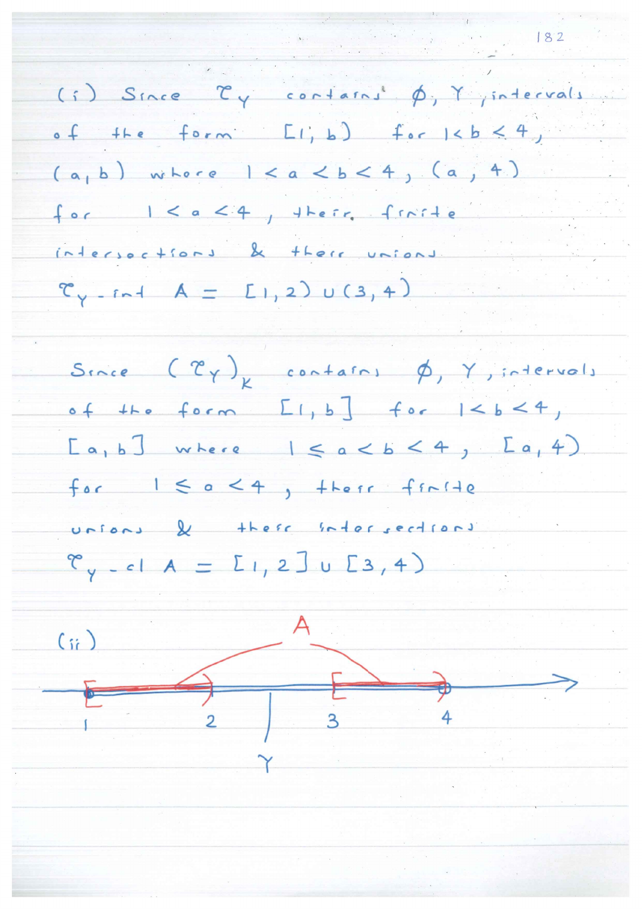
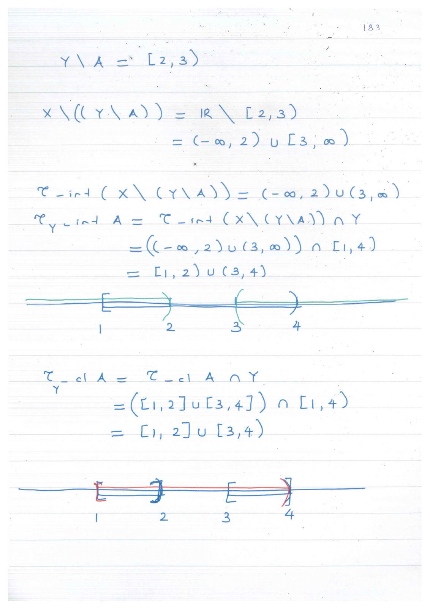

> [!ex] [Exercise 88 (Relative Operations on Half-Open Intervals)](Exercise%2088%20%28Relative%20Operations%20on%20Half-Open%20Intervals%29.md): In the usual real line, let $Y=[1,4)$ and $A=[1,2)\cup[3,4)$. Find $\operatorname{int}_Y(A)$ and $\operatorname{cl}_Y(A)$ using both the largest-open/smallest-closed characterization and the formulas in [Theorem 31 (Closure and Interior in Subspaces)](../Theorem%2031%20%28Closure%20and%20Interior%20in%20Subspaces%29.md).

###### Solution.
> [!sol] *Solution.* First use relative open and closed sets. The relative open intervals $[1,b)$, $(a,b)$, and $(a,4)$, together with their unions, give $\operatorname{int}_Y(A)=[1,2)\cup(3,4)$. The relative closed intervals $[1,b]$, $[a,b]$, and $[a,4)$ give $\operatorname{cl}_Y(A)=[1,2]\cup[3,4)$. 
>
> 
>
>  
>
> 
>
>  Alternatively, $Y\setminus A=[2,3)$ and $\mathbb{R}\setminus(Y\setminus A)=(-\infty,2)\cup[3,\infty)$. Its ambient interior is $(-\infty,2)\cup(3,\infty)$, whose intersection with $Y$ is $[1,2)\cup(3,4)$. Also, $\operatorname{cl}_{\mathbb{R}}(A)=[1,2]\cup[3,4]$, whose intersection with $Y$ is $[1,2]\cup[3,4)$. The supplied diagrams show the relative open and closed endpoints.$\blacksquare$

###### Dependencies.
- [Definition 01 (Topological Space)](Definition%2001%20(Topological%20Space).md)
- [Definition 16 (Interior)](../Definition%2016%20%28Interior%29.md)
- [Definition 19 (Closure)](../Definition%2019%20%28Closure%29.md)
- [Theorem 28 (Subspace Topology)](../Theorem%2028%20%28Subspace%20Topology%29.md)
- [Theorem 31 (Closure and Interior in Subspaces)](../Theorem%2031%20%28Closure%20and%20Interior%20in%20Subspaces%29.md)

###### References.
[1] Talu (2026 Fall) *Lecture*.
[2] [420-Week 7-Lecture 3.pdf](../_attachments/420-Week%207-Lecture%203.pdf) (pp. 181 (9)).
[3] [420-Week 8-Lecture 1.pdf](../_attachments/420-Week%208-Lecture%201.pdf) (pp. 181 (1), 182 (2), 183 (3)).

#mathematics #point-set-topology #exercise
