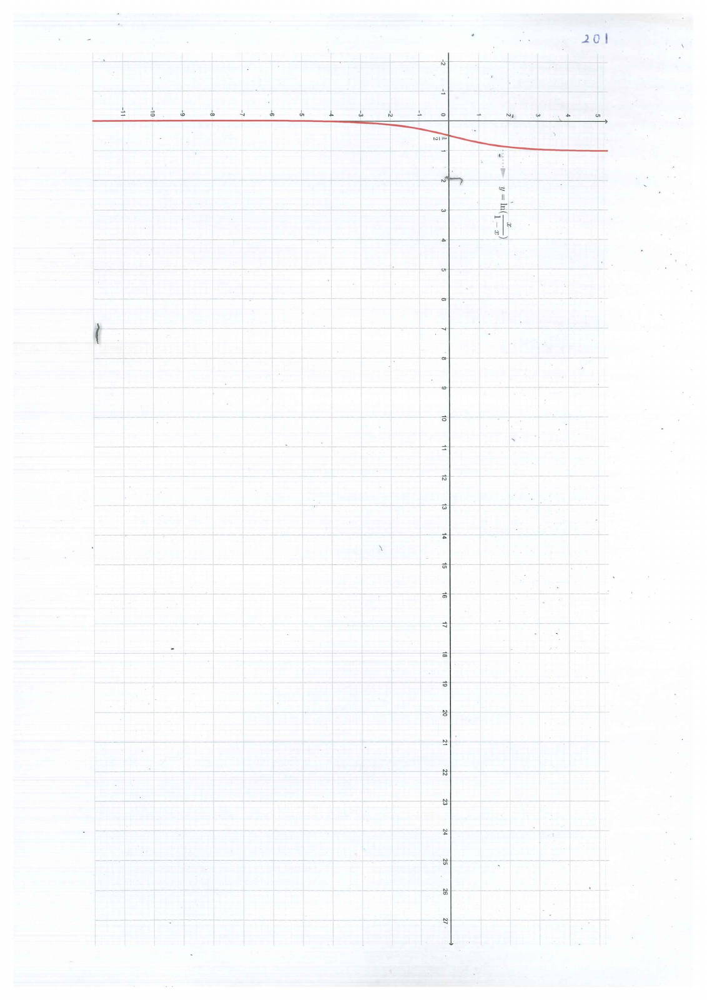

> [!ex] [Exercise 93 (Projections Need Not Be Closed)](Exercise%2093%20%28Projections%20Need%20Not%20Be%20Closed%29.md): Are product projections always closed functions? Consider the first projection $p_1:\mathbb{R}^2\to\mathbb{R}$ in the usual topologies.

> [!rem] The source states that the displayed graph is closed in $\mathbb{R}^2$ but does not supply a proof of that assertion.

###### Proof.
> [!pf] *Proof.* Let $f:(0,1)\to\mathbb{R}$ be $f(x)=\ln(x/(1-x))$, a homeomorphism. Its graph $K=\{(x,\ln(x/(1-x)))\mid x\in(0,1)\}$ is closed in $\mathbb{R}^2$, as asserted in the source. But $p_1(K)=(0,1)$ is not closed in $\mathbb{R}$. 
>
> 
>
>  Thus $p_1$ is not a closed function.$\blacksquare$

###### Dependencies.
- [Definition 01 (Topological Space)](Definition%2001%20(Topological%20Space).md)
- [Definition 02 (Closed Sets)](Definition%2002%20(Closed%20Sets).md)
- [Definition 06 (Open And Closed Functions)](Definition%2006%20(Open%20And%20Closed%20Functions).md)
- [Definition 07 (Homeomorphism)](Definition%2007%20(Homeomorphism).md)
- [Theorem 33 (Product Topology)](../Theorem%2033%20%28Product%20Topology%29.md)
- [Theorem 36 (Product Projections and Initial Topology)](../Theorem%2036%20%28Product%20Projections%20and%20Initial%20Topology%29.md)

###### References.
[1] Talu (2026 Fall) *Lecture*.
[2] [420-Week 8-Lecture 3.pdf](../_attachments/420-Week%208-Lecture%203.pdf) (pp. 200 (2), 201 (3), 202 (4)).

#mathematics #point-set-topology #exercise
