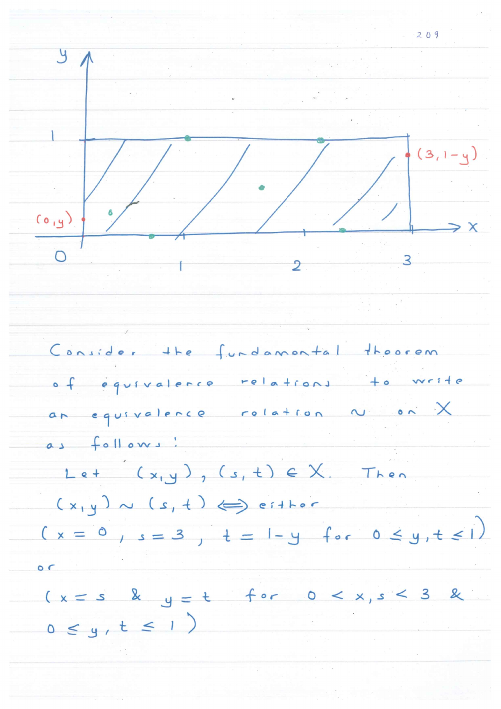

> [!ex] [Exercise 94 (Rectangle Partition with Reversed Heights)](Exercise%2094%20%28Rectangle%20Partition%20with%20Reversed%20Heights%29.md): Let $X=[0,3]\times[0,1]$. Consider the partition whose members are $A_y=\{(0,y),(3,1-y)\}$ for $0\le y\le1$ and $B_{xy}=\{(x,y)\}$ for $0<x<3$, $0\le y\le1$. Describe the associated equivalence relation and classes.

> [!rem] The source's displayed relation lists only the ordered boundary pair with first coordinate $0$ then $3$, and the interior identity case. It omits reverse boundary pairs and boundary reflexivity. The partition and the same-block criterion determine the intended equivalence relation; the omitted cases are retained explicitly below.

###### Solution.
> [!sol] *Solution.* Two points are equivalent precisely when they lie in one of the same displayed blocks. Thus the boundary classes are $[(0,y)]=[(3,1-y)]=A_y$ for $0\le y\le1$, and every point with $0<x<3$ has class $[(x,y)]=B_{xy}=\{(x,y)\}$. Equivalently, $(x,y)\sim(s,t)$ when the points are equal, or when $x=0$, $s=3$, $t=1-y$, or when $x=3$, $s=0$, $t=1-y$. 
>
> 
>
>  This is the relation determined by the supplied partition via [Theorem 39 (Equivalence Relations and Partitions)](../Theorem%2039%20%28Equivalence%20Relations%20and%20Partitions%29.md).$\blacksquare$

###### Dependencies.
- [0-Preliminaries](../0-Preliminaries.md)
- [Definition 30 (Relations)](../Definition%2030%20%28Relations%29.md)
- [Definition 31 (Equivalence Relations and Classes)](../Definition%2031%20%28Equivalence%20Relations%20and%20Classes%29.md)
- [Definition 32 (Partitions)](../Definition%2032%20%28Partitions%29.md)
- [Theorem 39 (Equivalence Relations and Partitions)](../Theorem%2039%20%28Equivalence%20Relations%20and%20Partitions%29.md)

###### References.
[1] Talu (2026 Fall) *Lecture*.
[2] [420-Week 8-Lecture 3.pdf](../_attachments/420-Week%208-Lecture%203.pdf) (pp. 208 (10), 209 (11), 210 (12)).

#mathematics #point-set-topology #exercise
