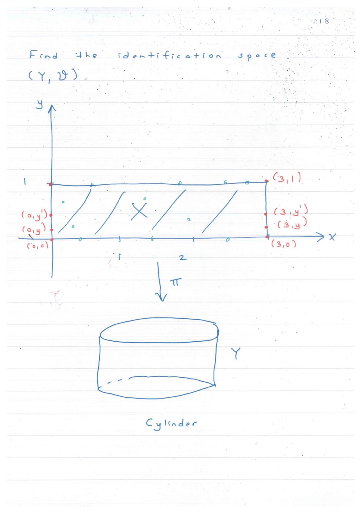
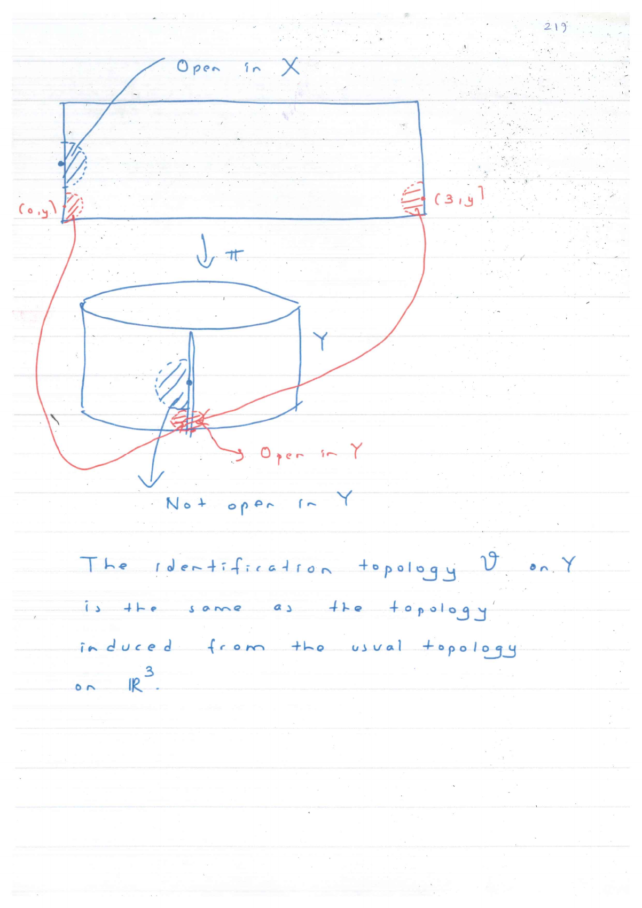
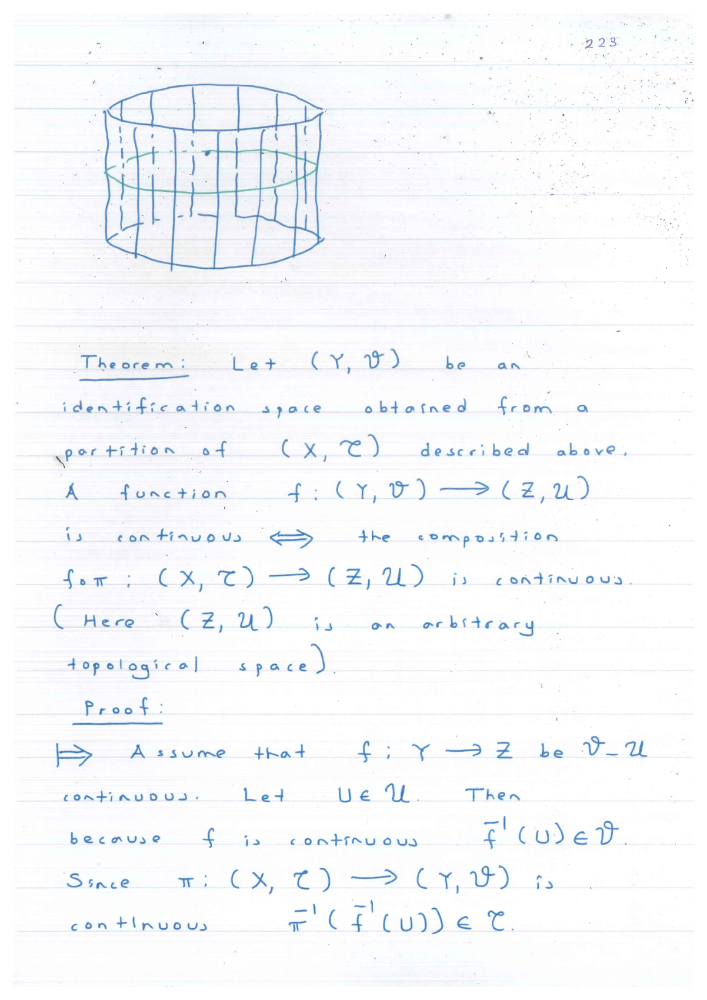

> [!ex] [Exercise 95 (Rectangle Partition with Equal Heights)](Exercise%2095%20%28Rectangle%20Partition%20with%20Equal%20Heights%29.md): For $X=[0,3]\times[0,1]$, use the partition with members $A_y=\{(0,y),(3,y)\}$ for $0\le y\le1$ and $B_{xy}=\{(x,y)\}$ for $0<x<3$, $0\le y\le1$. Describe its equivalence relation and classes. Give $X$ the usual subspace topology and find the resulting identification space.

> [!rem] The source's formula again omits reversed boundary pairs and boundary reflexivity, and its final singleton-class line does not require the two representatives to be equal. The same-block criterion from the stated partition resolves these omissions.

###### Solution.
> [!sol] *Solution.* The classes are $[(0,y)]=[(3,y)]=A_y$ on the vertical edges, and $[(x,y)]=B_{xy}=\{(x,y)\}$ for $0<x<3$. Thus $(x,y)\sim(s,t)$ when the points are equal, or when $x=0$, $s=3$, $y=t$, or when $x=3$, $s=0$, $y=t$. Distinct interior points have distinct singleton classes.
>
> For the usual subspace topology on $X$, identifying the vertical edges at equal heights gives a cylinder. Its identification topology agrees with the topology induced from the usual topology of $\mathbb{R}^3$. 
>
> 
>
>  The seam diagram contrasts an open set meeting only one vertical edge, whose image is not open, with paired edge pieces whose image is open. 
>
> 
>
>  
>
> 
>
>  For the general rectangular case, see [A. Quotient Space is Homeomorphic to the Cylinder](../A.%20Quotient%20Space%20is%20Homeomorphic%20to%20the%20Cylinder.md). The identification space is $S^1\times[0,1]$.$\blacksquare$

###### Dependencies.
- [0-Preliminaries](../0-Preliminaries.md)
- [Definition 30 (Relations)](../Definition%2030%20%28Relations%29.md)
- [Definition 31 (Equivalence Relations and Classes)](../Definition%2031%20%28Equivalence%20Relations%20and%20Classes%29.md)
- [Definition 32 (Partitions)](../Definition%2032%20%28Partitions%29.md)
- [Theorem 39 (Equivalence Relations and Partitions)](../Theorem%2039%20%28Equivalence%20Relations%20and%20Partitions%29.md)

- [Definition 01 (Topological Space)](../Definition%2001%20%28Topological%20Space%29.md)
- [Theorem 28 (Subspace Topology)](../Theorem%2028%20%28Subspace%20Topology%29.md)
- [Definition 34 (Quotient and Identification Topologies)](../Definition%2034%20%28Quotient%20and%20Identification%20Topologies%29.md)
- [Theorem 33 (Product Topology)](../Theorem%2033%20%28Product%20Topology%29.md)

###### References.
[1] Talu (2026 Fall) *Lecture*.
[2] [420-Week 8-Lecture 3.pdf](../_attachments/420-Week%208-Lecture%203.pdf) (pp. 210 (12), 211 (13)).

[3] [420-Week 9-Lecture 1.pdf](../_attachments/420-Week%209-Lecture%201.pdf) (pp. 217 (5), 218 (6), 219 (7), 223 (11)).

#mathematics #point-set-topology #exercise
