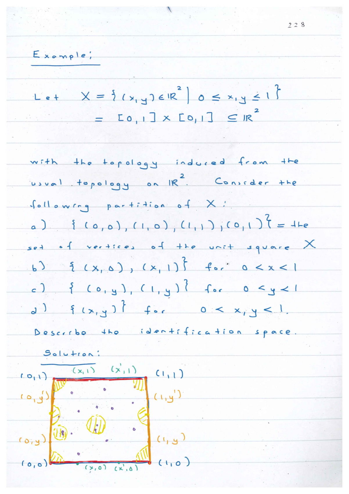
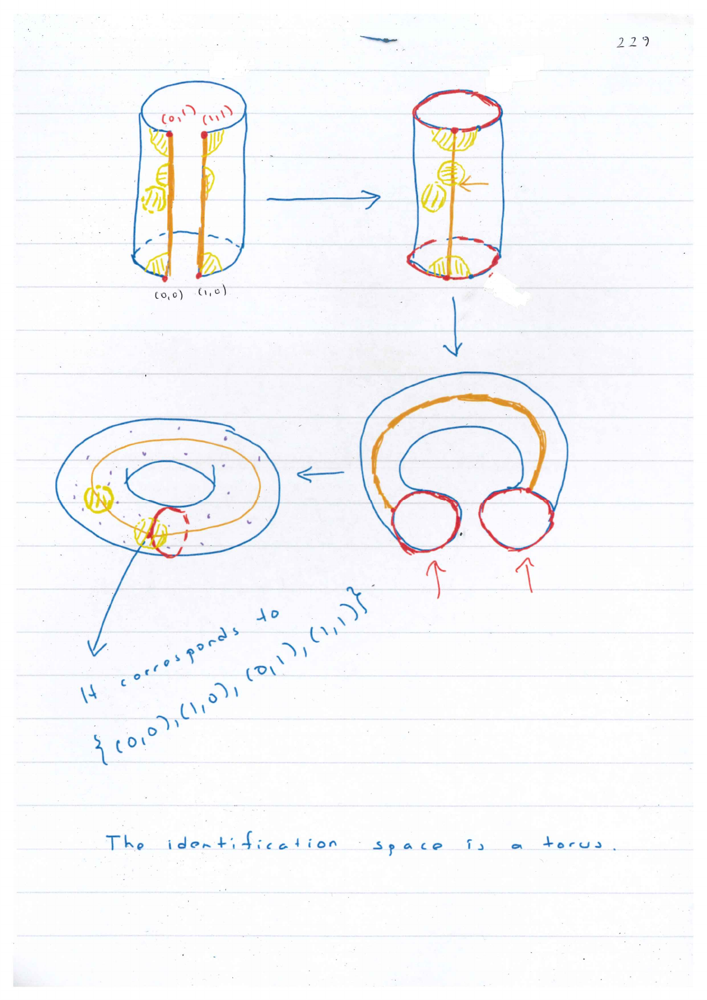
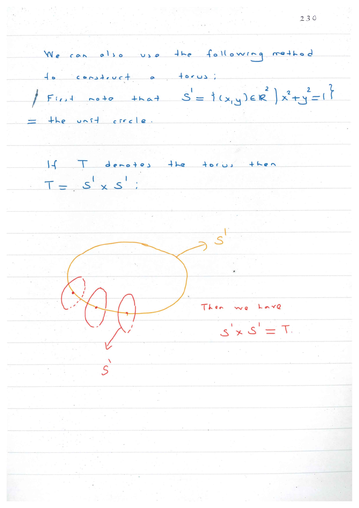

> [!ex] [Exercise 98 (Torus from the Unit Square)](Exercise%2098%20%28Torus%20from%20the%20Unit%20Square%29.md): Give $X=[0,1]\times[0,1]$ the usual subspace topology. Describe the identification space for the partition consisting of the block $\{(0,0),(1,0),(1,1),(0,1)\}$, the pairs $\{(x,0),(x,1)\}$ for $0<x<1$, the pairs $\{(0,y),(1,y)\}$ for $0<y<1$, and the singletons $\{(x,y)\}$ for $0<x,y<1$.

###### Solution.
> [!sol] *Solution.* The supplied construction identifies one pair of opposite edges to form a cylinder and then identifies the two remaining boundary circles. The result is a **torus**. The four vertices form a single point in the identification space; the drawings also show the corresponding neighbourhoods along the glued edges and at that point. 
>
> 
>
>  
>
> 
>
>  A second description uses the unit circle $S^1=\{(x,y)\in\mathbb{R}^2\mid x^2+y^2=1\}$. 
>
> 
>
>  The torus is $T=S^1\times S^1$.$\blacksquare$

###### Dependencies.
- [Definition 01 (Topological Space)](../Definition%2001%20%28Topological%20Space%29.md)
- [Theorem 28 (Subspace Topology)](../Theorem%2028%20%28Subspace%20Topology%29.md)
- [Definition 32 (Partitions)](../Definition%2032%20%28Partitions%29.md)
- [Definition 34 (Quotient and Identification Topologies)](../Definition%2034%20%28Quotient%20and%20Identification%20Topologies%29.md)
- [Theorem 33 (Product Topology)](../Theorem%2033%20%28Product%20Topology%29.md)

###### References.
[1] Talu (2026 Fall) *Lecture*.
[2] [420-Week 9-Lecture 2.pdf](../_attachments/420-Week%209-Lecture%202.pdf) (pp. 228 (6), 229 (7), 230 (8)).

#mathematics #point-set-topology #exercise
