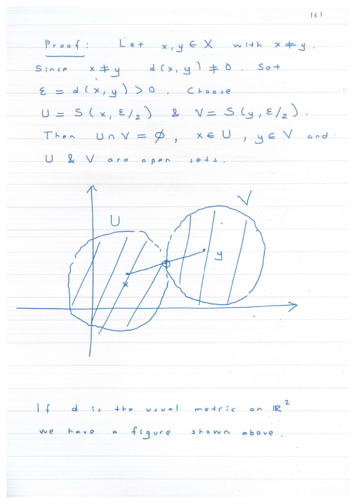

> [!thm] [Theorem 22 (Metric Spaces Are Hausdorff)](Theorem%2022%20%28Metric%20Spaces%20Are%20Hausdorff%29.md): In a metric space $(X,d)$, any two distinct points can be surrounded by disjoint open sets containing them. Thus every metric space is Hausdorff.

###### Examples.
> [!eg] Ex. 1: The usual metric on $\mathbb{R}^2$ is illustrated by disjoint balls: 
>
> 

###### Proof.
> [!pf] *Proof.* Let $x\ne y$ and set $\varepsilon=d(x,y)>0$. Choose $U=S_d(x,\varepsilon/2)$ and $V=S_d(y,\varepsilon/2)$. These are open sets containing $x$ and $y$, respectively, and $U\cap V=\emptyset$. Thus the required separation holds.$\blacksquare$

###### Dependencies.
- [Definition 24 (Metric Space)](Definition%2024%20%28Metric%20Space%29.md)
- [Definition 25 (Open Ball)](Definition%2025%20%28Open%20Ball%29.md)
- [Theorem 19 (Topology Induced by a Metric)](Theorem%2019%20%28Topology%20Induced%20by%20a%20Metric%29.md)
- [Theorem 20 (Open Balls Form a Basis)](Theorem%2020%20%28Open%20Balls%20Form%20a%20Basis%29.md)

- [Definition 42 (Hausdorff Spaces)](Definition%2042%20%28Hausdorff%20Spaces%29.md)

###### References.
[1] Talu (2026 Fall) *Lecture*.
[2] [420-Week 7-Lecture 1.pdf](_attachments/420-Week%207-Lecture%201.pdf) (pp. 160 (10)).
[3] [420-Week 7-Lecture 2.pdf](_attachments/420-Week%207-Lecture%202.pdf) (pp. 160 (1), 161 (2)).

[4] [420-Week 9-Lecture 3 photograph](_attachments/420-Week%209-Lecture%203/WhatsApp%20Image%202026-11-26%20at%2019.25.17%20%282%29.jpeg) (p. 247).
[5] [420-Week 9-Lecture 3 photograph](_attachments/420-Week%209-Lecture%203/WhatsApp%20Image%202026-11-26%20at%2019.25.17%20%281%29.jpeg) (p. 248).

#mathematics #point-set-topology #theorem
