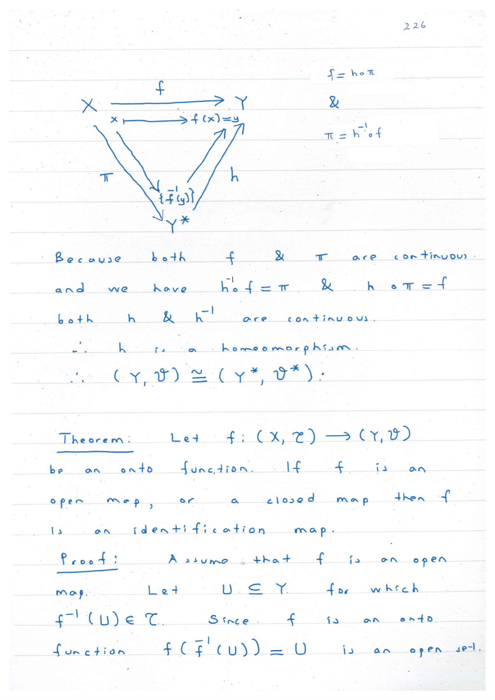

> [!thm] [Theorem 41 (Identification Maps and Fibre Spaces)](Theorem%2041%20%28Identification%20Maps%20and%20Fibre%20Spaces%29.md): Let $f:(X,\mathcal{T})\to(Y,\mathcal{V})$ be an onto function. Such a function gives rise to a partition of $X$ whose members are the subsets $f^{-1}(\{y\})$, where $y\in Y$. Let $Y^*$ denote the underlying set of the identification space associated with this partition, $\pi:X\to Y^*$ be the natural function, and $\mathcal{V}^*$ denote the identification topology on $Y^*$. If $f$ is an identification map, then:
> i. The spaces $(Y,\mathcal{V})$ and $(Y^*,\mathcal{V}^*)$ are homeomorphic.  
> ii. A function $g:(Y,\mathcal{V})\to(Z,\mathcal{U})$ is continuous if and only if the composition $g\circ f:X\to Z$ is continuous. (Here $(Z,\mathcal{U})$ is an arbitrary topological space.)

> [!rem] The lecture writes the fibre as $\{f^{-1}(y)\}$; here the standard notation $f^{-1}(\{y\})$ is used. In the shorter proof on p. 226, continuity of $f$ and $\pi$ alone does not imply continuity of $h$ and $h^{-1}$; the identification-map property is also used.

###### Examples.
> [!eg] Ex. 1: Let $X=\{a,b,c\}$ with $\mathcal{T}=\{\emptyset,\{a\},\{a,b\},X\}$ and let $Y=\{0,1\}$. Define a *surjective* function $f:X\to Y$ by $f(a)=f(b)=0$ and $f(c)=1$.
>
> **(i) Identification map.** To make $f$ an identification map, equip $Y$ with the *finest topology for which $f$ is continuous*:
>
> $$
> \mathcal{V}=\{V\subseteq Y\mid f^{-1}(V)\in\mathcal{T}\}=\{\emptyset,\{0\},Y\},
> $$
>
> since $f^{-1}(\{0\})=\{a,b\}\in\mathcal{T}$ and $f^{-1}(\{1\})=\{c\}\notin\mathcal{T}$.
>
> **(ii) Identification space.** The fibres $A=f^{-1}(\{0\})=\{a,b\}$ and $B=f^{-1}(\{1\})=\{c\}$ determine the partition $Y^*=\{A,B\}$. Define the natural function $\pi:X\to Y^*$ by $\pi(a)=\pi(b)=A$, $\pi(c)=B$. Equip $Y^*$ with the *finest topology for which $\pi$ is continuous*:
>
> $$
> \mathcal{V}^*=\{W\subseteq Y^*\mid\pi^{-1}(W)\in\mathcal{T}\}=\{\emptyset,\{A\},Y^*\}.
> $$
>
> **(iii) Homeomorphism.** Define the bijection $h:Y^*\to Y$ by $h(A)=0$, $h(B)=1$. Since $h$ maps the open sets $\emptyset,\{A\},Y^*$ onto $\emptyset,\{0\},Y$, respectively, both $h$ and $h^{-1}$ are continuous. Hence $h$ is a homeomorphism and $(Y^*,\mathcal{V}^*)\cong(Y,\mathcal{V})$.

###### Proof.
> [!pf] *Proof.* Let us prove (i) (the proof of (ii) is similar to the proof of [Theorem 40 (Continuity from Identification Spaces)](Theorem%2040%20%28Continuity%20from%20Identification%20Spaces%29.md), using the identification topology of $f$). Define $h:(Y^*,\mathcal{V}^*)\to(Y,\mathcal{V})$ by
>
> $$
> h(f^{-1}(\{y\}))=y.
> $$
>
> The function $h$ is a bijection. Moreover,
>
> $$
> h\circ\pi=f,\qquad h^{-1}\circ f=\pi.
> $$
>
> 
>
> Let $V\in\mathcal{V}$. Then
>
> $$
> (h\circ\pi)^{-1}(V)=\pi^{-1}(h^{-1}(V))=f^{-1}(V).
> $$
>
> Recall that
>
> $$
> \mathcal{V}^*=\{W\subseteq Y^*\mid\pi^{-1}(W)\in\mathcal{T}\}.
> $$
>
> Since $f$ is $\mathcal{T}$-$\mathcal{V}$ continuous, $f^{-1}(V)\in\mathcal{T}$ for $V\in\mathcal{V}$. Thus $\pi^{-1}(h^{-1}(V))\in\mathcal{T}$. By the definition of $\mathcal{V}^*$, $h^{-1}(V)\in\mathcal{V}^*$. Therefore, $h$ is continuous.
>
> Let $V^*\in\mathcal{V}^*$. Since $\pi$ is continuous, $\pi^{-1}(V^*)\in\mathcal{T}$. Since $\pi=h^{-1}\circ f$,
>
> $$
> \begin{aligned}
> \pi^{-1}(V^*)&=(h^{-1}\circ f)^{-1}(V^*)\\
> &=f^{-1}((h^{-1})^{-1}(V^*))\\
> &=f^{-1}(h(V^*))\in\mathcal{T}.
> \end{aligned}
> $$
>
> Since $f$ is an identification map,
>
> $$
> \mathcal{V}=\{V\subseteq Y\mid f^{-1}(V)\in\mathcal{T}\}.
> $$
>
> Thus $h(V^*)\in\mathcal{V}$, that is, $(h^{-1})^{-1}(V^*)\in\mathcal{V}$. Consequently $h^{-1}$ is continuous. Hence $h$ is a homeomorphism.$\blacksquare$

> [!pf] *Proof.* (Shorter argument from p. 226 for (i).) Because both $f$ and $\pi$ are continuous, we have that $h\circ\pi=f$ and $h^{-1}\circ f=\pi$ are continuous. By [Theorem 40 (Continuity from Identification Spaces)](Theorem%2040%20%28Continuity%20from%20Identification%20Spaces%29.md) and (ii), respectively (the latter follows by the same argument as that theorem), both $h$ and $h^{-1}$ are continuous. Therefore, $h$ is a homeomorphism and $(Y,\mathcal{V})\cong(Y^*,\mathcal{V}^*)$.$\blacksquare$

###### Dependencies.
- [Definition 01 (Topological Space)](Definition%2001%20%28Topological%20Space%29.md)
- [Definition 05 (Continuous Functions)](Definition%2005%20%28Continuous%20Functions%29.md)
- [Definition 07 (Homeomorphism)](Definition%2007%20%28Homeomorphism%29.md)
- [Definition 35 (Identification Maps)](Definition%2035%20%28Identification%20Maps%29.md)
- [Definition 34 (Quotient and Identification Topologies)](Definition%2034%20%28Quotient%20and%20Identification%20Topologies%29.md)
- [Theorem 40 (Continuity from Identification Spaces)](Theorem%2040%20%28Continuity%20from%20Identification%20Spaces%29.md)
- [Definition 32 (Partitions)](Definition%2032%20%28Partitions%29.md)
- [Proposition 03 (Composition Of Continuous Functions)](Proposition%2003%20%28Composition%20Of%20Continuous%20Functions%29.md)
- [0-Preliminaries](0-Preliminaries.md)

###### References.
[1] Talu (2026 Fall) *Lecture*.
[2] [420-Week 9-Lecture 2.pdf](_attachments/420-Week%209-Lecture%202.pdf) (pp. 224 (1), 225 (2), 226(a) (3), 226 (4)).

#mathematics #point-set-topology #theorem
