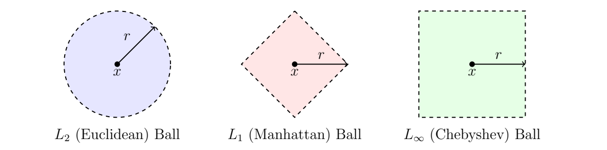
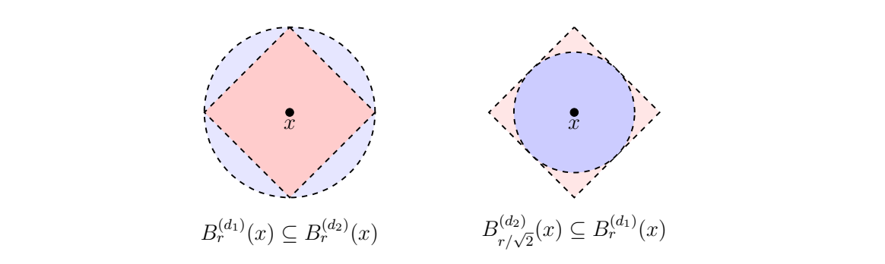

> [!def] [Definition 0-1 (Metric Space)](Definition%200-1%20(Metric%20Space).md): A **metric space** is a set $X$ with a function $d:X\times X\to\mathbb{R}$ satisfying, for all $x,y,z\in X$:  
> i. $d(x,y)\geq0$, with equality if and only if $x=y$.  
> ii. $d(x,y)=d(y,x)$ (symmetry).  
> iii. $d(x,z)\leq d(x,y)+d(y,z)$ (triangle inequality).  
> For $r>0$, the **open ball** is $B_r(x)=\{y\in X\mid d(x,y)<r\}$ and the **closed ball** is $\overline{B}_r(x)=\{y\in X\mid d(x,y)\leq r\}$. The **metric topology** declares $U\subseteq X$ open when every $x\in U$ has some $r>0$ with $B_r(x)\subseteq U$.

> [!rem] For $x,y\in\mathbb{R}^{n}$, common metrics are Euclidean distance $d_2$, Manhattan distance $d_1$, and Chebyshev distance $d_{\infty}$:
>
> $$
> d_2(x,y)=\sqrt{\sum_{i=1}^{n}(x_i-y_i)^2},\qquad d_1(x,y)=\sum_{i=1}^{n}|x_i-y_i|,\qquad d_{\infty}(x,y)=\max_{1\leq i\leq n}|x_i-y_i|.
> $$
>
> They induce the same standard topology although their balls have different shapes. Two metrics $d,d'$ induce the same topology if and only if for every $x$ and $r>0$ there are $r_1,r_2>0$ with
>
> $$
> B_{r_1}^{(d)}(x)\subseteq B_r^{(d')}(x),\qquad B_{r_2}^{(d')}(x)\subseteq B_r^{(d)}(x).
> $$
>
> The relevant inequalities are $d_2\leq d_1\leq\sqrt{n}\,d_2$ and $d_{\infty}\leq d_2\leq\sqrt{n}\,d_{\infty}$. The second inequality in the first pair follows from Cauchy-Schwarz. In data analysis these metrics change the numerical scales at which features appear, but not the underlying topology of $\mathbb{R}^{n}$.

###### Motivation.
Point clouds in topological data analysis come with a *notion of distance*. A metric supplies a topology through its open balls.

###### Examples.
> [!eg] Ex. 1: For $x=(1,2)$ and $y=(4,6)$, the coordinate differences are $3,4$, so $d_2(x,y)=5$, $d_1(x,y)=7$, and $d_{\infty}(x,y)=4$. Thus $4\leq5\leq7\leq7.07$, consistent with the inequalities.

> [!eg] Ex. 2: On any set $X$, the **discrete metric** is $d(x,y)=0$ for $x=y$ and $d(x,y)=1$ otherwise. It satisfies all metric axioms. For $0<r\leq1$, $B_r(x)=\{x\}$ (in particular $B_{0.5}(x)=\{x\}$); for $r>1$, $B_r(x)=X$. Every subset $A=\bigcup_{a\in A}\{a\}$ is open, so the induced topology is $\mathcal{P}(X)$. Every subset is also closed. Points are isolated and no continuous path joins distinct points.

> [!eg] Ex. 3: 

> [!eg] Ex. 4: 

###### Proof.
> [!pf] *Proof.* Open balls are open: if $y\in B_r(x)$, put $s=r-d(x,y)>0$. For $z\in B_s(y)$, the triangle inequality gives $d(x,z)\leq d(x,y)+d(y,z)<d(x,y)+s=r$, so $B_s(y)\subseteq B_r(x)$. Closed balls are closed as stated in the source. For equality of the $d_1$ and $d_2$ topologies, if $U$ is $d_2$-open and $B_r^{(d_2)}(x)\subseteq U$, then $B_r^{(d_1)}(x)\subseteq B_r^{(d_2)}(x)\subseteq U$ because $d_2\leq d_1$. Conversely, if $B_r^{(d_1)}(x)\subseteq U$, then $B_{r/\sqrt{n}}^{(d_2)}(x)\subseteq B_r^{(d_1)}(x)\subseteq U$ because $d_1\leq\sqrt{n}\,d_2$. The inequalities for $d_{\infty}$ give the same argument. $\blacksquare$

###### Dependencies.
- [Definition 15 (Topological Space)](Definition%2015%20%28Topological%20Space%29.md)
- Cauchy-Schwarz Inequality {unresolved}

###### References.
[1] Pamuk (2026 Fall) *Lecture*.

[2] Pamuk, M. (2026). *[MATH423: Introduction to Computational Topology](_materials/Pamuk-1.pdf)* (pp. 2 (2), 3 (3), 4 (4)).

#mathematics #computational-topology #definition
