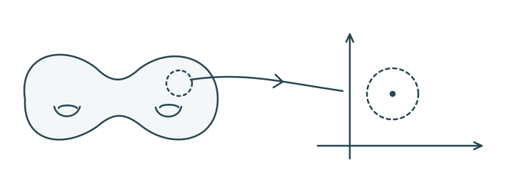

> [!def] [[Definition 11 (N-Dimensional Manifold)]]: An **$n$-dimensional manifold** is a second-countable Hausdorff space in which each point has an open neighborhood homeomorphic to the open disk in $\mathbb{R}^{n}$.

> [!rem] The Hausdorff condition is necessary: the line with two origins is locally homeomorphic to the line but fails to be Hausdorff.

###### Examples.
> [!eg] Ex. 1: $\mathbb{R}^{n}$ and every open subset of $\mathbb{R}^{n}$ are $n$-manifolds.

> [!eg] Ex. 2: The sphere $S^n$ is an $n$-manifold: each point lies in $S^n\setminus\{N\}$ or $S^n\setminus\{S\}$, each homeomorphic to $\mathbb{R}^{n}$ by stereographic projection.

> [!eg] Ex. 3: The figure eight is not a $1$-manifold. Removing the crossing from a small connected neighborhood leaves four components; removing a point from an open interval leaves two.

> [!eg] Ex. 4: 

> [!eg] Ex. 5: The figure eight is not a $1$-manifold (see [Exercise 16 (Figure Eight Manifold Test)](Exercises/Exercise%2016%20%28Figure%20Eight%20Manifold%20Test%29.md)).

###### Dependencies.
- [Definition 17 (Hausdorff Space)](Definition%2017%20%28Hausdorff%20Space%29.md)
- [Definition 21 (Homeomorphism)](Definition%2021%20%28Homeomorphism%29.md)
- Second Countability {unresolved}

###### References.
[1] Pamuk (2026 Fall) *Lecture*.

[2] Pamuk, M. (2026). *[MATH423: Introduction to Computational Topology](_materials/Pamuk-1.pdf)* (pp. 10 (10)).

[3] Pamuk (2026 Fall) *Lecture*. [Previously supplied handwritten source](_attachments/23eac36d-M11-9fc3243c93cf.png).

[4] Pamuk, M. (2026). *[Midterm 1 Preparation Worksheet](_materials/Pamuk%20-%20Midterm%201%20Preparation%20Worksheet.pdf)* (pp. 1 (1), 7 (7)).

#mathematics #computational-topology #definition
