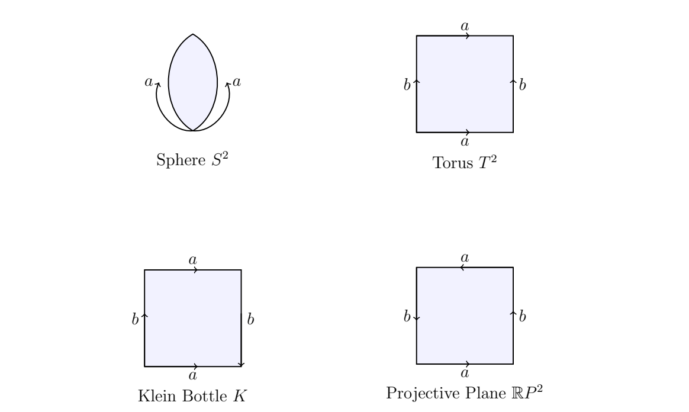

> [!def] [Definition 23 (Polygonal Presentation)](Definition%2023%20%28Polygonal%20Presentation%29.md): A **polygonal presentation** constructs a compact surface from a planar polygon by identifying its edges in pairs. Its **boundary word** records a traversal of the boundary: write $a$ if the edge arrow agrees with the traversal and $a^{-1}$ if it opposes it.

> [!rem] The resulting cell decomposition has one face, one edge per distinct letter, and vertices equal to the equivalence classes of polygon corners. Thus $\chi=V-E+1$. Label corners $P_0,P_1,\ldots$ in boundary order. Direct each edge using its sign; paired copies of a letter identify their start points and their end points. Different words may give the same surface. Cutting along a diagonal and regluing along paired edges brings words toward canonical forms.

> [!rem] For integral $H_1$, [Proposition 10 (First Homology from Polygon Words)](Proposition%2010%20%28First%20Homology%20from%20Polygon%20Words%29.md) applies only when all corners form one vertex class. The mod-$2$ calculation uses the vertex classes for $\chi$, orientability from the signs in the word, and [Proposition 03 (Betti Numbers of Closed Surfaces)](Proposition%2003%20%28Betti%20Numbers%20of%20Closed%20Surfaces%29.md) for the resulting Betti numbers.

###### Examples.
> [!eg] Ex. 1: 

> [!eg] Ex. 2: The sphere has the $2$-gon word $aa^{-1}$, whose sides fold together like a zipper. Both arrows run $P_0\to P_1$, so the corners remain distinct: $V=2,E=1,F=1$, giving $\chi=2$.

> [!eg] Ex. 3: The torus has word $aba^{-1}b^{-1}$. Its directed edges are $a:P_0\to P_1$, $b:P_1\to P_2$, $a:P_3\to P_2$, $b:P_0\to P_3$. The $a$-gluing gives $P_0\sim P_3,P_1\sim P_2$ and the $b$-gluing gives $P_1\sim P_0,P_2\sim P_3$. All corners coincide: $V=1,E=2,F=1$, so $\chi=0$. Also $T^2=S^1\times S^1$.

> [!eg] Ex. 4: The Klein bottle word read from the figure is $ab^{-1}a^{-1}b^{-1}$. Renaming $b^{-1}$ as $b$ gives the equivalent $aba^{-1}b$. The Klein bottle has no boundary.

> [!eg] Ex. 5: The projective plane has $2$-gon word $aa$, identifying $P_0\sim P_1$ and giving $V=1,E=1,\chi=1$. It also has square word $abab$: the $a$ and $b$ identifications both give $P_0\sim P_2,P_1\sim P_3$, so $V=2,E=2,\chi=1$. This identifies antipodal disk boundary points.

> [!eg] Ex. 6: The word $aabb$ gives $a:P_0\to P_1$, $a:P_1\to P_2$, $b:P_2\to P_3$, $b:P_3\to P_0$. All corners coincide, so $V=1,E=2,\chi=0$. It is the non-orientable Klein bottle $\mathbb{RP}^{2}\#\mathbb{RP}^{2}$, rather than $\mathbb{RP}^{2}$.

> [!eg] Ex. 7: The $4g$-gon word $a_1b_1a_1^{-1}b_1^{-1}\cdots a_gb_ga_g^{-1}b_g^{-1}$ identifies all corners. Hence $V=1,E=2g$, and $\chi=2-2g$.

> [!eg] Ex. 8: For $abca^{-1}b^{-1}c^{-1}$, the edges are $a:P_0\to P_1$, $b:P_1\to P_2$, $c:P_2\to P_3$, $a:P_4\to P_3$, $b:P_5\to P_4$, $c:P_0\to P_5$. The identifications are $P_0\sim P_4,P_1\sim P_3$; $P_1\sim P_5,P_2\sim P_4$; $P_2\sim P_0,P_3\sim P_5$. There are two classes, $\{P_0,P_2,P_4\}$ and $\{P_1,P_3,P_5\}$. Thus $V=2,E=3,F=1,\chi=0$. Each letter occurs once with each sign, so [Theorem 06 (Classification of Closed Surfaces)](Theorem%2006%20%28Classification%20of%20Closed%20Surfaces%29.md) identifies the torus; this is its hexagonal presentation that tiles the plane.

> [!eg] Ex. 9: Worksheet result: {unresolved}; see [Exercise 08 (Hexagon Surface Identification)](Exercises/Exercise%2008%20%28Hexagon%20Surface%20Identification%29.md).

> [!eg] Ex. 10: The word $abab$ presents $\mathbb{RP}^{2}$ (see [Exercise 18 (Square Word abab)](Exercises/Exercise%2018%20%28Square%20Word%20abab%29.md)).

> [!eg] Ex. 11: The words give $\mathbb{RP}^{2}$, the sum of three projective planes, and the torus, respectively (see [Exercise 35 (Three Hexagon Presentations)](Exercises/Exercise%2035%20%28Three%20Hexagon%20Presentations%29.md)).

> [!eg] Ex. 12: The word presents a torus with $b=(1,2,1)$; its two vertex classes prevent direct application of the integral recipe (see [Exercise 94 (Homology of a Hexagonal Torus)](Exercises/Exercise%2094%20%28Homology%20of%20a%20Hexagonal%20Torus%29.md)).

###### Dependencies.
- [Definition 19 (Quotient Topology)](Definition%2019%20%28Quotient%20Topology%29.md)
- [Definition 12 (Surface)](Definition%2012%20%28Surface%29.md)
- [Definition 26 (Euler Characteristic)](Definition%2026%20%28Euler%20Characteristic%29.md)
- [Definition 24 (Orientability)](Definition%2024%20%28Orientability%29.md)
- [Theorem 06 (Classification of Closed Surfaces)](Theorem%2006%20%28Classification%20of%20Closed%20Surfaces%29.md)
- [Proposition 10 (First Homology from Polygon Words)](Proposition%2010%20%28First%20Homology%20from%20Polygon%20Words%29.md)
- [Proposition 03 (Betti Numbers of Closed Surfaces)](Proposition%2003%20%28Betti%20Numbers%20of%20Closed%20Surfaces%29.md)

###### References.
[1] Pamuk (2026 Fall) *Lecture*.

[2] Pamuk, M. (2026). *[MATH423: Introduction to Computational Topology](_materials/Pamuk-1.pdf)* (pp. 11 (11), 12 (12)).

[3] Pamuk, M. (2026). *[Triangulations, Classification of Surfaces and Abstract Simplicial Complexes](_materials/Pamuk-2.pdf)* (pp. 6 (6)).

[4] Pamuk, M. (2026). *[Midterm 1 Preparation Worksheet](_materials/Pamuk%20-%20Midterm%201%20Preparation%20Worksheet.pdf)* (pp. 1 (1), 2 (2), 7 (7), 8 (8)).

[5] Pamuk, M. (2026). *[Lecture notes on simplicial homology](_materials/Pamuk-4.pdf)* (pp. 13 (13), 15 (15), 16 (16), 18 (18), 19 (19)).

#mathematics #computational-topology #definition
