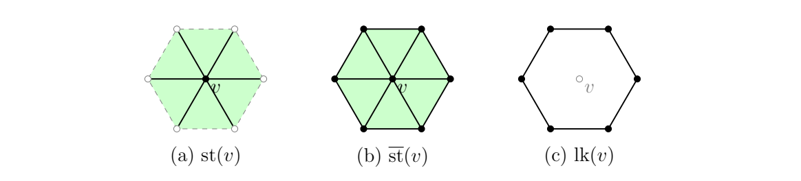

> [!def] [Definition 29 (Skeletons Stars and Links)](Definition%2029%20%28Skeletons%20Stars%20and%20Links%29.md): Let $K$ be an abstract simplicial complex and $\sigma\in K$. A **subcomplex** is a subset $L\subseteq K$ closed under nonempty faces. The **$k$-skeleton** $K^{(k)}$ consists of simplices of dimension at most $k$. The **star** is $\operatorname{st}(\sigma)=\{\tau\in K\mid\sigma\subseteq\tau\}$. The **closed star** $\overline{\operatorname{st}}(\sigma)$ is the smallest subcomplex containing the star, consisting of all faces of its simplices. The **link** is
>
> $$
> \operatorname{lk}(\sigma)=\{\tau\in\overline{\operatorname{st}}(\sigma)\mid\tau\cap\sigma=\emptyset\}.
> $$
>
> For a vertex $v$, $\operatorname{lk}(v)=\{\tau\in K\mid v\notin\tau,\ \tau\cup\{v\}\in K\}$. The **open star** is the union of interiors of the simplices in the star.

> [!rem] The star collects cofaces upwards, whereas face closure goes downwards. Faces not containing $\sigma$ are missing from the star; the closed star restores them, and the link keeps the faces disjoint from $\sigma$. Except for isolated vertices, the star is not a subcomplex; see [Proposition 02 (Star Subcomplex Criterion)](Proposition%2002%20%28Star%20Subcomplex%20Criterion%29.md). The open star is open in $|K|$ and contains the interior of $\sigma$; it is the natural neighborhood of $\sigma$. Its closure is the closed-star polyhedron. For a vertex, the link is the frontier added in passing to this closure, and
>
> $$
> \overline{\operatorname{st}}(v)=\operatorname{st}(v)\sqcup\operatorname{lk}(v).
> $$
>
> This decomposition need not hold for higher dimensional simplices. The link of a vertex in a closed triangulated surface is a circle; the source asks for a proof in Worksheet 1, Problem 6. Edge links enter the later link condition for edge contractions.

###### Examples.
> [!eg] Ex. 1: For the tetrahedron boundary and $v=1$,
>
> $$
> \operatorname{st}(1)=\{\{1\},\{1,2\},\{1,3\},\{1,4\},\{1,2,3\},\{1,2,4\},\{1,3,4\}\}.
> $$
>
> These seven simplices do not form a subcomplex: $\{2,3\}$ is a face of $\{1,2,3\}$ but does not contain $1$, and $\{2\},\{3\},\{4\}$ are absent despite being faces of star edges. The closed star adds exactly $\{2\},\{3\},\{4\},\{2,3\},\{2,4\},\{3,4\}$, giving $13$ simplices and a triangulated disk. These six added simplices form $\operatorname{lk}(1)$, the hollow triangle on $\{2,3,4\}$ and the disk boundary.

> [!eg] Ex. 2: 

> [!eg] Ex. 3: For $\sigma=\{1,2\}$ in the tetrahedron boundary, $\operatorname{st}(\sigma)=\{\{1,2\},\{1,2,3\},\{1,2,4\}\}$. Its closed star is the two triangles with all their faces: nine simplices. The link is $\{\{3\},\{4\}\}$; $\{3,4\}$ is not in the closed star. The two link points correspond to the two triangles adjacent to the edge. The simplices $\{1\},\{2\},\{1,3\},\{2,3\},\{1,4\},\{2,4\}$ meet $\sigma$ without containing it and are in neither its star nor its link.

> [!eg] Ex. 4: Worksheet result: {unresolved}; see [Exercise 06 (Vertex Links in Closed Surfaces)](Exercises/Exercise%2006%20%28Vertex%20Links%20in%20Closed%20Surfaces%29.md).

> [!eg] Ex. 5: Every vertex link is a cycle with at least three vertices, and every vertex has degree at least three (see [Exercise 42 (Cycles in Vertex Links)](Exercises/Exercise%2042%20%28Cycles%20in%20Vertex%20Links%29.md)).

> [!eg] Ex. 6: The condition holds for the octahedron edge and fails for the tetrahedron edge (see [Exercise 81 (Link Condition for Edge Contraction)](Exercises/Exercise%2081%20%28Link%20Condition%20for%20Edge%20Contraction%29.md)).

> [!eg] Ex. 7: $f=(6,8,2)$, $\chi=0$; the links of $1$, $\{1,3\}$, and $4$ are a path, two points, and an edge with two isolated points (see [Exercise 45 (Counting Simplices Stars and Links)](Exercises/Exercise%2045%20%28Counting%20Simplices%20Stars%20and%20Links%29.md)).

###### Dependencies.
- [Definition 28 (Abstract Simplicial Complex)](Definition%2028%20%28Abstract%20Simplicial%20Complex%29.md)
- [Definition 9 (Polyhedron)](Definition%209%20%28Polyhedron%29.md)
- Definition 15 (Topological Space) {unresolved}; see [Definition 1 (Topological Space)](../MATH420%20-%20Point-Set%20Topology/Definition%201%20%28Topological%20Space%29.md)

###### References.
[1] Pamuk (2026 Fall) *Lecture*.

[2] Pamuk, M. (2026). *[MATH423: Introduction to Computational Topology: Lecture Notes](_materials/Pamuk-3.pdf)* (pp. 3 (3), 4 (4), 5 (5)).

[3] Pamuk, M. (2026). *[Midterm 1 Preparation Worksheet](_materials/Pamuk%20-%20Midterm%201%20Preparation%20Worksheet.pdf)* (pp. 3 (3), 5 (5), 9 (9), 12 (12)).

#mathematics #computational-topology #definition
