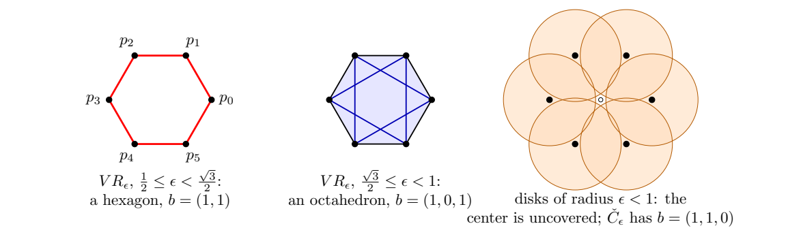

> [!def] [Definition 31 (Čech Complex)](Definition%2031%20%28%C4%8Cech%20Complex%29.md): Let $X=\{x_1,\ldots,x_N\}$ be a finite subset of a metric space and let $\epsilon>0$. The **Čech complex** $\check{C}_{\epsilon}(X)$ is the nerve of the closed radius-$\epsilon$ balls centered at $X$. A nonempty vertex set $\sigma$ is a simplex precisely when
>
> $$
> \bigcap_{x_i\in\sigma}\overline{B}_{\epsilon}(x_i)\ne\emptyset.
> $$
>

> [!rem] For $X\subseteq\mathbb{R}^{n}$ the balls are convex, so [Theorem 09 (Nerve Theorem)](Theorem%2009%20%28Nerve%20Theorem%29.md) gives a homotopy equivalence between $\check{C}_{\epsilon}(X)$ and $\bigcup_i\overline{B}_{\epsilon}(x_i)$. A simplex appears exactly when its points fit inside a radius-$\epsilon$ closed ball, equivalently when their smallest enclosing ball has radius at most $\epsilon$. Simultaneous intersection tests become expensive in high dimensions. For two Euclidean points an edge appears when $d(x_i,x_j)\leq2\epsilon$ {the source states this without restricting the ambient metric space; outside Euclidean space this equivalence is unresolved here}. For a triangle the smallest enclosing ball is the circumcircle for an acute or right triangle, and has the longest side as diameter for an obtuse triangle. Thus an acute triangle enters at its circumradius and an obtuse one at half its longest side.

> [!rem] In Euclidean space, the critical values are smallest enclosing radii of subsets. List the critical values, identify the complex between consecutive values, then compute its Betti numbers. By [Theorem 09 (Nerve Theorem)](Theorem%2009%20%28Nerve%20Theorem%29.md) and [Theorem 13 (Homotopy Invariance of Homology)](Theorem%2013%20%28Homotopy%20Invariance%20of%20Homology%29.md), Čech homology agrees with the homology of the union of its balls.

###### Examples.
> [!eg] Ex. 1: The Čech complex is a hollow triangle at radius $1$ and a filled triangle at radius $\sqrt{2}$ (see [Exercise 05 (Equilateral Triangle Complexes)](Exercises/Exercise%2005%20%28Equilateral%20Triangle%20Complexes%29.md)).

> [!eg] Ex. 2: Worksheet result: {unresolved}; see [Exercise 09 (Filtration of a Rectangle)](Exercises/Exercise%2009%20%28Filtration%20of%20a%20Rectangle%29.md).

> [!eg] Ex. 3: At intermediate thresholds the planar hexagon has $b_2=1$ in its Vietoris-Rips complex. A planar Čech complex is homotopy equivalent to a union of disks in the plane and has $b_2=0$. A Rips complex is not required to lie in the plane; short-lived classes such as the hexagon’s $H_2$ are often regarded as noise in persistent homology.

> [!eg] Ex. 4: The cavity exists for $1.3\leq\rho<4.3\,\text{Å}$ (see [Exercise 84 (Molecular Cavity Probe Radius)](Exercises/Exercise%2084%20%28Molecular%20Cavity%20Probe%20Radius%29.md)).

> [!eg] Ex. 5: The inclusions are hollow triangle $\subseteq$ filled triangle $\subseteq$ filled triangle (see [Exercise 49 (Equilateral Triangle at Scale 1.1)](Exercises/Exercise%2049%20%28Equilateral%20Triangle%20at%20Scale%201.1%29.md)).

> [!eg] Ex. 6: Čech is contained in Vietoris-Rips at the same scale in any metric space (see [Exercise 72 (Čech Inclusion in Metric Spaces)](Exercises/Exercise%2072%20%28%C4%8Cech%20Inclusion%20in%20Metric%20Spaces%29.md)).

> [!eg] Ex. 7: For the six vertices $p_0,\ldots,p_5$ of the regular unit hexagon and $\sqrt{3}/2\leq\epsilon<1$, the Čech and Rips edges agree. The six triples of consecutive vertices have obtuse angle and smallest enclosing radius $\sqrt{3}/2$, so they give Čech triangles. The two alternating triples are equilateral with circumradius $1$ and do not enter yet. Thus the Čech $f$-vector is $(6,12,6)$, $\chi=0$, and $b=(1,1,0)$. The union of disks is an annulus missing the center. At the same scale the Rips complex is an octahedron boundary with $b=(1,0,1)$. There is no conflict with [Lemma 02 (Čech and Vietoris-Rips Interleaving)](Lemma%2002%20%28%C4%8Cech%20and%20Vietoris-Rips%20Interleaving%29.md): $\sqrt{2}\epsilon\geq\sqrt{6}/2>1$, where the enlarged Čech complex is already full.
>
> 

> [!eg] Ex. 8: Rips has the homology of a point from $1/2$ onward; Čech has $b=(1,6)$ on $[1/2,1/\sqrt{3})$ before also having the homology of a point (see [Exercise 89 (Hexagon and Center Filtrations)](Exercises/Exercise%2089%20%28Hexagon%20and%20Center%20Filtrations%29.md)).

> [!eg] Ex. 9: Both triangles enter at $\epsilon=5/2$ (see [Exercise 90 (Full Triangle Entry Scale)](Exercises/Exercise%2090%20%28Full%20Triangle%20Entry%20Scale%29.md)).

> [!eg] Ex. 10: The answers are false, true, and true (see [Exercise 97 (Cones and Planar Homology Tests)](Exercises/Exercise%2097%20%28Cones%20and%20Planar%20Homology%20Tests%29.md)).

###### Dependencies.
- [Definition 0-1 (Metric Space)](Definition%200-1%20(Metric%20Space).md)
- [Definition 30 (Nerve)](Definition%2030%20%28Nerve%29.md)
- [Theorem 09 (Nerve Theorem)](Theorem%2009%20%28Nerve%20Theorem%29.md)
- Smallest Enclosing Ball {unresolved}
- [Definition 32 (Vietoris-Rips Complex)](Definition%2032%20%28Vietoris-Rips%20Complex%29.md)
- [Definition 36 (Simplicial Homology)](Definition%2036%20%28Simplicial%20Homology%29.md)
- [Theorem 13 (Homotopy Invariance of Homology)](Theorem%2013%20%28Homotopy%20Invariance%20of%20Homology%29.md)
- [Lemma 02 (Čech and Vietoris-Rips Interleaving)](Lemma%2002%20%28%C4%8Cech%20and%20Vietoris-Rips%20Interleaving%29.md)

###### References.
[1] Pamuk (2026 Fall) *Lecture*.

[2] Pamuk, M. (2026). *[MATH423: Introduction to Computational Topology: Lecture Notes](_materials/Pamuk-3.pdf)* (pp. 6 (6), 7 (7), 8 (8)).

[3] Pamuk, M. (2026). *[Worked Calculations for Sections 6.1–6.4](_materials/Pamuk-Applications-3.pdf)* (pp. 6 (6)).

[4] Pamuk, M. (2026). *[Midterm 1 Preparation Worksheet](_materials/Pamuk%20-%20Midterm%201%20Preparation%20Worksheet.pdf)* (pp. 3 (3), 5 (5), 6 (6), 9 (9), 11 (11), 12 (12), 13 (13)).

[5] Pamuk, M. (2026). *[Lecture notes on simplicial homology](_materials/Pamuk-4.pdf)* (pp. 3 (3), 11 (11), 12 (12), 16 (16), 18 (18), 19 (19), 20 (20)).

#mathematics #computational-topology #definition
