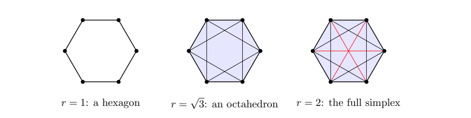

> [!def] [Definition 32 (Vietoris-Rips Complex)](Definition%2032%20%28Vietoris-Rips%20Complex%29.md): For a finite point cloud $X$ and $\epsilon>0$, the **Vietoris-Rips complex** $\operatorname{VR}_{\epsilon}(X)$ has as simplices the nonempty subsets $\sigma\subseteq X$ of diameter at most $2\epsilon$. Equivalently, $d(x_i,x_j)\leq2\epsilon$ for every pair $x_i,x_j\in\sigma$.

> [!rem] Some texts use the maximum distance $\delta$ as scale, requiring $d(x_i,x_j)\leq\delta$. Here $\delta=2\epsilon$ for comparison with the Čech complex of radius $\epsilon$. The Vietoris-Rips complex is a **clique complex** or **flag complex**: compute its $1$-skeleton by pairwise distances, then add every clique as a higher dimensional simplex. It is cheaper to compute than Čech, but need not be homotopy equivalent to the union of balls.

###### Examples.
> [!eg] Ex. 1: Let $X=\{0,1,3,4\}\subseteq\mathbb{R}$. At $\epsilon=1$, edges are $\{0,1\},\{1,3\},\{3,4\}$; $\{0,3\},\{0,4\},\{1,4\}$ are too long. The complex is the contractible path $0-1-3-4$. At $\epsilon=1.5$, distance-$3$ edges $\{0,3\},\{1,4\}$ appear, giving cliques $\{0,1,3\}$ and $\{1,3,4\}$, two triangles sharing $\{1,3\}$. At $\epsilon=2$ all pairs join and the complex is the full $3$-simplex.

> [!eg] Ex. 2: Worksheet result: {unresolved}; see [Exercise 05 (Equilateral Triangle Complexes)](Exercises/Exercise%2005%20%28Equilateral%20Triangle%20Complexes%29.md).

> [!eg] Ex. 3: Worksheet result: {unresolved}; see [Exercise 09 (Filtration of a Rectangle)](Exercises/Exercise%2009%20%28Filtration%20of%20a%20Rectangle%29.md).

> [!eg] Ex. 4: For a regular unit hexagon use $r=2\epsilon$. Distances are $1,\sqrt{3},2$ for neighbors, second neighbors and opposite vertices. For $r<1$ there are six isolated points ($b_0=6$). For $1\leq r<\sqrt{3}$ only consecutive vertices are joined and there are no triangles: $n=(6,6)$ and $b=(1,1)$ since $\operatorname{rank}\partial_1=5$. For $\sqrt{3}\leq r<2$, a simplex uses at most one vertex per opposite pair, giving $2^3=8$ triangles, $12$ edges and no tetrahedra. This is the octahedron boundary with $n=(6,12,8)$ and $b=(1,0,1)$ by [Proposition 03 (Betti Numbers of Closed Surfaces)](Proposition%2003%20%28Betti%20Numbers%20of%20Closed%20Surfaces%29.md). The loop disappears and a two-dimensional void appears. For $r\geq2$ the three opposite diagonals appear and the full $5$-simplex has the homology of a point.
>
> 

> [!eg] Ex. 5: A full simplex on a nonempty point set has the homology of a point (see [Exercise 28 (Full Rips Complex Homology)](Exercises/Exercise%2028%20%28Full%20Rips%20Complex%20Homology%29.md)).

> [!eg] Ex. 6: The complexes are six points, a hexagonal cycle, an octahedron boundary, and a full $5$-simplex (see [Exercise 50 (Vietoris-Rips Filtration of a Hexagon)](Exercises/Exercise%2050%20%28Vietoris-Rips%20Filtration%20of%20a%20Hexagon%29.md)).

> [!eg] Ex. 7: There are $2^N-1$ simplices, including $161{,}700$ triangles when $N=100$ (see [Exercise 51 (Counting Simplices in Dense Rips)](Exercises/Exercise%2051%20%28Counting%20Simplices%20in%20Dense%20Rips%29.md)).

> [!eg] Ex. 8: The tuples are $(1,1)$, $(1,0,1)$, and $(1,0,0,0,0,0)$ (see [Exercise 63 (Betti Numbers of Hexagonal Rips)](Exercises/Exercise%2063%20%28Betti%20Numbers%20of%20Hexagonal%20Rips%29.md)).

> [!eg] Ex. 9: The truncated complex reports $2$ instead of $1$ (see [Exercise 80 (False Voids from Truncation)](Exercises/Exercise%2080%20%28False%20Voids%20from%20Truncation%29.md)).

> [!eg] Ex. 10: The interior failure makes a Rips hole. The corner failure leaves an uncovered point without a surrounding Rips cycle (see [Exercise 85 (Failed Sensors on Square Grids)](Exercises/Exercise%2085%20%28Failed%20Sensors%20on%20Square%20Grids%29.md)).

> [!eg] Ex. 11: The inclusions are hollow triangle $\subseteq$ filled triangle $\subseteq$ filled triangle (see [Exercise 49 (Equilateral Triangle at Scale 1.1)](Exercises/Exercise%2049%20%28Equilateral%20Triangle%20at%20Scale%201.1%29.md)).

###### Dependencies.
- [Definition 0-1 (Metric Space)](Definition%200-1%20(Metric%20Space).md)
- [Definition 28 (Abstract Simplicial Complex)](Definition%2028%20%28Abstract%20Simplicial%20Complex%29.md)
- [Definition 29 (Skeletons Stars and Links)](Definition%2029%20%28Skeletons%20Stars%20and%20Links%29.md)
- [Definition 31 (Čech Complex)](Definition%2031%20%28%C4%8Cech%20Complex%29.md)
- [Proposition 03 (Betti Numbers of Closed Surfaces)](Proposition%2003%20%28Betti%20Numbers%20of%20Closed%20Surfaces%29.md)
- [Theorem 11 (Zeroth Homology Counts Components)](Theorem%2011%20%28Zeroth%20Homology%20Counts%20Components%29.md)
- [Definition 36 (Simplicial Homology)](Definition%2036%20%28Simplicial%20Homology%29.md)

###### References.
[1] Pamuk (2026 Fall) *Lecture*.

[2] Pamuk, M. (2026). *[MATH423: Introduction to Computational Topology: Lecture Notes](_materials/Pamuk-3.pdf)* (pp. 6 (6), 7 (7), 8 (8)).

[3] Pamuk, M. (2026). *[Worked Calculations for Sections 6.1–6.4](Pamuk-Applications-3.pdf)* (pp. 5 (5), 6 (6)).

[4] Pamuk, M. (2026). *[Midterm 1 Preparation Worksheet](_materials/Pamuk%20-%20Midterm%201%20Preparation%20Worksheet.pdf)* (pp. 2 (2), 3 (3), 4 (4), 5 (5), 6 (6), 8 (8), 9 (9), 10 (10), 11 (11), 12 (12), 13 (13)).

#mathematics #computational-topology #definition
