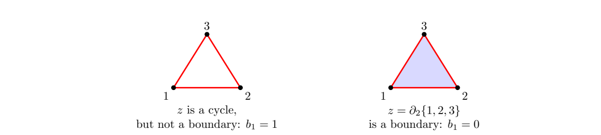

> [!def] [Definition 35 (Betti Number)](Definition%2035%20%28Betti%20Number%29.md): The **$k$-th Betti number** over $\mathbb{Z}/2$ is $b_k=\dim H_k(K;\mathbb{Z}/2)$. If $K$ has $n_k$ simplices of dimension $k$, then
>
> $$
> b_k=n_k-\operatorname{rank}\partial_k-\operatorname{rank}\partial_{k+1}.
> $$
>

> [!rem] $b_k$ depends only on the $(k+1)$-skeleton, since only $\partial_k$ and $\partial_{k+1}$ enter its rank formula. In the top dimension $d$, $b_d=\dim Z_d$. To compute $b_1$, vertices, edges and triangles suffice.

###### Examples.
> [!eg] Ex. 1: For the tetrahedron boundary, use the matrices in [Definition 34 (Simplicial Boundary Operator)](Definition%2034%20%28Simplicial%20Boundary%20Operator%29.md). Row additions $R_2\gets R_1+R_2$, $R_3\gets R_2+R_3$, $R_4\gets R_3+R_4$ give echelon rows $(1,1,1,0,0,0)$, $(0,1,1,1,1,0)$, $(0,0,1,0,1,1)$, and zero. Thus $\operatorname{rank}\partial_1=3$. The first three columns of $\partial_2$ sum to the fourth, $(0,0,0,1,1,1)^{\mathsf{T}}$. A zero linear combination of the first three has coefficients $a,b,c$ satisfying $b+c=a+c=a+b=0$ from rows $14,13,12$, and $a=0$ from row $23$. Hence $\operatorname{rank}\partial_2=3$. With $n=(4,6,4)$ and $\partial_3=0$, $b=(4-0-3,6-3-3,4-3-0)=(1,0,1)$. The first three triangle boundaries span the three-dimensional $Z_1=B_1$. The sum of all four faces spans $Z_2$, and $B_2=0$, so it represents the sphere’s void.

> [!eg] Ex. 2: Adding the tetrahedron $1234$ gives $\partial_3(1234)=234+134+124+123$. This all-ones column has rank one and turns the former generator of $H_2$ into a boundary. The first two boundary ranks stay $3,3$. With $n=(4,6,4,1)$ the Betti tuple is $(1,6-3-3,4-3-1,1-1-0)=(1,0,0,0)$, and $\chi=4-6+4-1=1$. The full tetrahedron has the homology of a point.

> [!eg] Ex. 3: The Betti tuples are $(1,3)$, $(1,6)$, and $(1,7)$ (see [Exercise 55 (Betti Numbers of Three Graphs)](Exercises/Exercise%2055%20%28Betti%20Numbers%20of%20Three%20Graphs%29.md)).

> [!eg] Ex. 4: The Betti tuples are $(1,0,0)$ and $(1,1,0)$ (see [Exercise 57 (Homology of Two Mixed Complexes)](Exercises/Exercise%2057%20%28Homology%20of%20Two%20Mixed%20Complexes%29.md)).

> [!eg] Ex. 5: The Betti tuple is $(1,2)$ and the two triangle loops give a basis of $H_1$ (see [Exercise 56 (Two Loops at One Vertex)](Exercises/Exercise%2056%20%28Two%20Loops%20at%20One%20Vertex%29.md)).

> [!eg] Ex. 6: The annulus has Betti tuple $(1,1,0)$ and its two boundary loops are homologous (see [Exercise 59 (Homology of a Triangulated Annulus)](Exercises/Exercise%2059%20%28Homology%20of%20a%20Triangulated%20Annulus%29.md)).

> [!eg] Ex. 7: For a single vertex $v$, $C_0=\mathbb{Z}/2$, all other chain groups vanish, and $H_0=C_0$, giving $b=(1,0,\ldots)$.

> [!eg] Ex. 8: In the hollow triangle the three $\partial_1$ rows sum to zero and any two are independent, so the rank is $2$. Since there is no $2$-simplex, $b_0=3-2=1$, $b_1=3-2=1$, and the perimeter cycle $z=12+13+23$ spans $Z_1$ and does not bound. Adding the triangle keeps $\operatorname{rank}\partial_1=2$ but adds the rank-one boundary column $\partial_2(123)=z$. Now $b=(1,3-2-1,1-1)=(1,0,0)$.
>
> 

> [!eg] Ex. 9: For the tetrahedron boundary, the top rank can be computed without row reduction: every edge belongs to two faces, so a nonempty $2$-cycle that includes any face must include its three neighbors. The sum of all four is the only nonzero $2$-cycle and gives $\operatorname{rank}\partial_2=4-1=3$.

> [!eg] Ex. 10: {unresolved} (see [Exercise 98 (Programming Betti Numbers)](Exercises/Exercise%2098%20%28Programming%20Betti%20Numbers%29.md)).

###### Proof.
> [!pf] *Proof.* By [Definition 33 (Simplicial Chain)](Definition%2033%20%28Simplicial%20Chain%29.md), $\dim C_k=n_k$. Rank–nullity gives $\dim Z_k=n_k-\operatorname{rank}\partial_k$, and $B_k=\operatorname{im}\partial_{k+1}$ gives $\dim B_k=\operatorname{rank}\partial_{k+1}$. Since $B_k\subseteq Z_k$, the quotient has dimension $\dim H_k=\dim Z_k-\dim B_k$, yielding the rank formula. $\blacksquare$

###### Dependencies.
- [Definition 36 (Simplicial Homology)](Definition%2036%20%28Simplicial%20Homology%29.md)
- [Definition 34 (Simplicial Boundary Operator)](Definition%2034%20%28Simplicial%20Boundary%20Operator%29.md)
- [Definition 33 (Simplicial Chain)](Definition%2033%20%28Simplicial%20Chain%29.md)
- Rank–Nullity Theorem {unresolved}
- [Definition 29 (Skeletons Stars and Links)](Definition%2029%20%28Skeletons%20Stars%20and%20Links%29.md)

###### References.
[1] Pamuk (2026 Fall) *Lecture*.

[2] Pamuk, M. (2026). *[Worked Calculations for Sections 6.1–6.4](_materials/Pamuk-Applications-3.pdf)* (pp. 1 (1), 2 (2), 3 (3), 4 (4), 5 (5), 6 (6), 7 (7), 8 (8)).

[3] Pamuk, M. (2026). *[Midterm 1 Preparation Worksheet](_materials/Pamuk%20-%20Midterm%201%20Preparation%20Worksheet.pdf)* (pp. 2 (2), 4 (4), 7 (7), 10 (10), 11 (11), 12 (12)).

[4] Pamuk (2026 Fall) *Lecture*. [Cycles, boundaries, and homology](_attachments/handwritten-homology/cycles-and-homology.png) (handwritten source).

[5] Pamuk (2026 Fall) *Lecture*. [Chain complex and tetrahedron boundary](_attachments/handwritten-homology/tetrahedron-chain-complex.png) (handwritten source).

[6] Pamuk, M. (2026). *[Lecture notes on simplicial homology](_materials/Pamuk-4.pdf)* (pp. 5 (5), 6 (6), 8 (8), 18 (18), 20 (20)).

#mathematics #computational-topology #definition
