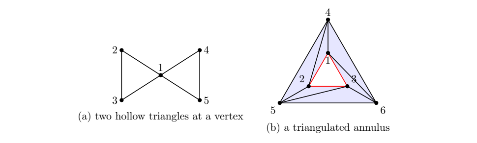

> [!def] [Definition 36 (Simplicial Homology)](Definition%2036%20%28Simplicial%20Homology%29.md): A $k$-chain $c$ is a **$k$-cycle** if $\partial_kc=0$; these form $Z_k=\ker\partial_k$. It is a **$k$-boundary** if $c=\partial_{k+1}d$ for some $(k+1)$-chain $d$; these form $B_k=\operatorname{im}\partial_{k+1}$. By [Lemma 03 (Boundary of a Boundary)](Lemma%2003%20%28Boundary%20of%20a%20Boundary%29.md), $B_k\subseteq Z_k$. The **$k$-th homology group** over $\mathbb{Z}/2$ is $H_k(K;\mathbb{Z}/2)=Z_k/B_k$. Two cycles are **homologous** if their difference, which equals their sum over $\mathbb{Z}/2$, is a boundary.

###### Examples.
> [!eg] Ex. 1: The two hollow triangles in [Exercise 56 (Two Loops at One Vertex)](Exercises/Exercise%2056%20%28Two%20Loops%20at%20One%20Vertex%29.md) give two independent loop classes. For the annulus in [Exercise 59 (Homology of a Triangulated Annulus)](Exercises/Exercise%2059%20%28Homology%20of%20a%20Triangulated%20Annulus%29.md), the two boundary loops give the same nonzero class.
>
> 

> [!eg] Ex. 2: A hollow triangle has a cycle that does not bound (see [Exercise 24 (Cycles Need Not Bound)](Exercises/Exercise%2024%20%28Cycles%20Need%20Not%20Bound%29.md)).

> [!eg] Ex. 3: The classifications are both, neither, both, and cycle only (see [Exercise 54 (Cycles in a Triangulated Square)](Exercises/Exercise%2054%20%28Cycles%20in%20a%20Triangulated%20Square%29.md)).

> [!eg] Ex. 4: The Betti tuple is $(1,2)$ and the two triangle loops give a basis of $H_1$ (see [Exercise 56 (Two Loops at One Vertex)](Exercises/Exercise%2056%20%28Two%20Loops%20at%20One%20Vertex%29.md)).

> [!eg] Ex. 5: The annulus has Betti tuple $(1,1,0)$ and its two boundary loops are homologous (see [Exercise 59 (Homology of a Triangulated Annulus)](Exercises/Exercise%2059%20%28Homology%20of%20a%20Triangulated%20Annulus%29.md)).

> [!eg] Ex. 6: The ranks are $3,1$, the Betti tuple is $(3,0,0)$, and the classes of $1,4,6$ give a basis of $H_0$ (see [Exercise 58 (Three Connected Components)](Exercises/Exercise%2058%20%28Three%20Connected%20Components%29.md)).

> [!eg] Ex. 7: The Betti tuple is $(1,0,4)$ (see [Exercise 65 (Homology of a Two-Skeleton)](Exercises/Exercise%2065%20%28Homology%20of%20a%20Two-Skeleton%29.md)).

> [!eg] Ex. 8: The composite boundary is zero, so every boundary is a cycle (see [Exercise 74 (Boundary of a Boundary)](Exercises/Exercise%2074%20%28Boundary%20of%20a%20Boundary%29.md)).

###### Dependencies.
- [Definition 33 (Simplicial Chain)](Definition%2033%20%28Simplicial%20Chain%29.md)
- [Definition 34 (Simplicial Boundary Operator)](Definition%2034%20%28Simplicial%20Boundary%20Operator%29.md)
- [Lemma 03 (Boundary of a Boundary)](Lemma%2003%20%28Boundary%20of%20a%20Boundary%29.md)
- Quotient Vector Space {unresolved}

###### References.
[1] Pamuk (2026 Fall) *Lecture*.

[2] Pamuk, M. (2026). *[Worked Calculations for Sections 6.1–6.4](Pamuk-Applications-3.pdf)* (pp. 2 (2), 3 (3), 4 (4), 5 (5), 6 (6), 7 (7), 8 (8)).

[3] Pamuk, M. (2026). *[Midterm 1 Preparation Worksheet](_materials/Pamuk%20-%20Midterm%201%20Preparation%20Worksheet.pdf)* (pp. 2 (2), 4 (4), 5 (5), 7 (7), 10 (10), 11 (11), 12 (12)).

[4] Pamuk (2026 Fall) *Lecture*. [Cycles, boundaries, and homology](_attachments/handwritten-homology/cycles-and-homology.png) (handwritten source).

[5] Pamuk (2026 Fall) *Lecture*. [Chain complex and tetrahedron boundary](_attachments/handwritten-homology/tetrahedron-chain-complex.png) (handwritten source).

#mathematics #computational-topology #definition
