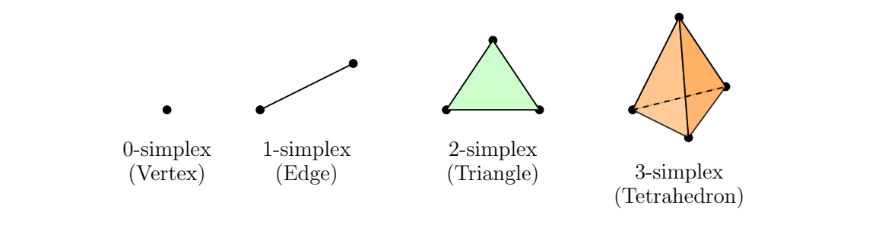
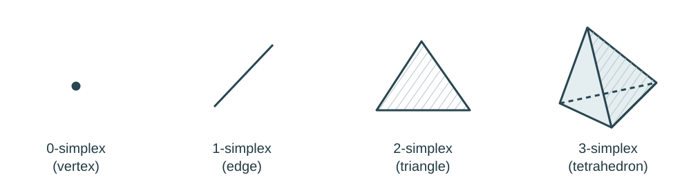

> [!def] [[Definition 6 (K-Simplex)]]: Let $v_0,\ldots,v_k\in\mathbb{R}^{n}$ be **geometrically independent**, meaning that $v_1-v_0,\ldots,v_k-v_0$ are linearly independent. Their **$k$-simplex** is the set of convex combinations
>
> $$
> \sigma=\left\{\sum_{i=0}^{k}t_iv_i\;\middle|\;\sum_{i=0}^{k}t_i=1,\ t_i\geq0\text{ for every }i\right\}.
> $$
>
> For each $x\in\sigma$, its unique coefficients $(t_0,\ldots,t_k)$ are its **barycentric coordinates**. Restricting coefficients to zero gives a **face**, spanned by a subset of the vertices. A face spanned by all but one vertex is a **facet**, of dimension $k-1$. The point with $t_i=1/(k+1)$ for every $i$ is the **barycenter**.

> [!rem] Counting nonempty vertex subsets, a $k$-simplex has $\binom{k+1}{j+1}$ faces of dimension $j$ and $2^{k+1}-1$ faces in total, including itself. A tetrahedron has $4$ vertices, $6$ edges, $4$ triangles, and one tetrahedron, totaling $15$.

###### Motivation.
Simplices give *combinatorial building blocks* determined entirely by their vertices: points, line segments, triangles, and higher dimensional analogues.

###### Examples.
> [!eg] Ex. 1: The collinear points $(0,0),(1,0),(2,0)$ are not geometrically independent: their difference vectors are parallel and their convex hull is a segment, not a triangle. At most $n+1$ points in $\mathbb{R}^{n}$ are geometrically independent, so $k\leq n$.

> [!eg] Ex. 2: For $v_0=(0,0)$, $v_1=(4,0)$, $v_2=(0,4)$, $x=(1,2)=(4t_1,4t_2)$ has coordinates $(t_0,t_1,t_2)=(1/4,1/4,1/2)$. They are positive, so $x$ is interior. The point $(2,2)$ has $t_0=0$ and lies on the facet spanned by $v_1,v_2$; $(3,3)$ has $t_0=-1/2$ and lies outside.

> [!eg] Ex. 3: 

> [!eg] Ex. 4: 

###### Dependencies.
- Linear Independence {unresolved}
- Convex Combination {unresolved}

###### References.
[1] Pamuk (2026 Fall) *Lecture*.

[2] Pamuk, M. (2026). *[MATH423: Introduction to Computational Topology](_materials/Pamuk-1.pdf)* (pp. 8 (8), 9 (9)).

#mathematics #computational-topology #definition
