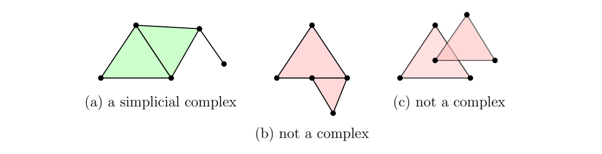

> [!def] [[Definition 7 (Simplicial Complex)]]: A **simplicial complex** $K$ in $\mathbb{R}^{n}$ is a finite collection of simplices such that:  
> i. Every face of a simplex of $K$ belongs to $K$.  
> ii. The nonempty intersection of two simplices of $K$ is a face of each.

> [!rem] Face closure excludes a triangle missing its edges. The intersection condition excludes a vertex resting inside another triangle’s edge unless it coincides with a vertex of that triangle.

###### Motivation.
To build more complex spaces, we *glue simplices together* in a structured way.

###### Examples.
> [!eg] Ex. 1: 

> [!eg] Ex. 2: Two triangles sharing a full edge with an extra edge attached at a vertex form a complex. An intersection equal to only half an edge of one triangle is not a face of that triangle. Overlap in a region that is not a face of either triangle is also forbidden.

> [!eg] Ex. 3: Existing lecture examples: ![[Pasted image 20261008173243.png]]

> [!eg] Ex. 4: Existing lecture non-examples: ![[Pasted image 20261008173258.png|642]]

###### Dependencies.
- [Definition 6 (K-Simplex)](Definition%206%20%28K-Simplex%29.md)

###### References.
[1] Pamuk (2026 Fall) *Lecture*.

[2] Pamuk, M. (2026). *[MATH423: Introduction to Computational Topology](_materials/Pamuk-1.pdf)* (pp. 9 (9)).

#mathematics #computational-topology #definition
