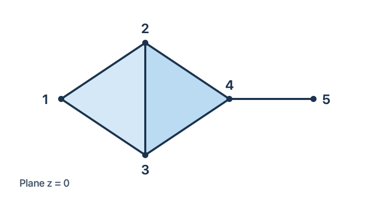

> [!ex] [Exercise 04 (Complex from Maximal Simplices)](Exercise%2004%20%28Complex%20from%20Maximal%20Simplices%29.md): Let $V=\{1,2,3,4,5\}$ and let $K$ have maximal simplices $\{1,2,3\}$, $\{2,3,4\}$ and $\{4,5\}$.  
> (a) List every simplex of $K$.  
> (b) Determine $\dim K$.  
> (c) Sketch $|K|$ in $\mathbb{R}^{3}$.  
> (d) Compute the $f$-vector and Euler characteristic.

###### Solution.
> [!sol] *Solution.* **(a)** The simplices are the nonempty faces of the three maximal simplices. Listed by dimension, they are
>
> $$
> \begin{aligned}
> K_0 &= \bigl\{\{1\},\{2\},\{3\},\{4\},\{5\}\bigr\},\\
> K_1 &= \bigl\{\{1,2\},\{1,3\},\{2,3\},\{2,4\},\{3,4\},\{4,5\}\bigr\},\\
> K_2 &= \bigl\{\{1,2,3\},\{2,3,4\}\bigr\},
> \end{aligned}
> $$
>
> where $K_i$ denotes the set of $i$-simplices.
>
> **(b)** The largest simplices have three vertices, so $\dim K=2$.
>
> **(c)** The two filled triangles share exactly the edge $\{2,3\}$. The segment $\{4,5\}$ meets the union of the triangles only at vertex $4$. A realization in the plane $z=0$ is shown below.
>
> 
>
> **(d)** The $f$-vector is $f(K)=(5,6,2)$, so $\chi(K)=5-6+2=1$. $\blacksquare$

###### Dependencies.
- [Definition 28 (Abstract Simplicial Complex)](../Definition%2028%20%28Abstract%20Simplicial%20Complex%29.md)
- [Definition 8 (Dimension Of A Simplicial Complex)](../Definition%208%20%28Dimension%20Of%20A%20Simplicial%20Complex%29.md)
- [Definition 9 (Polyhedron)](../Definition%209%20%28Polyhedron%29.md)
- [Definition 26 (Euler Characteristic)](../Definition%2026%20%28Euler%20Characteristic%29.md)

###### References.
[1] Pamuk (2026 Fall) *Lecture*.

[2] Pamuk, M. (2026). *[MATH423: Introduction to Computational Topology: Lecture Notes](../_materials/Pamuk-3.pdf)* (pp. 9 (9)).

#mathematics #computational-topology #exercise
