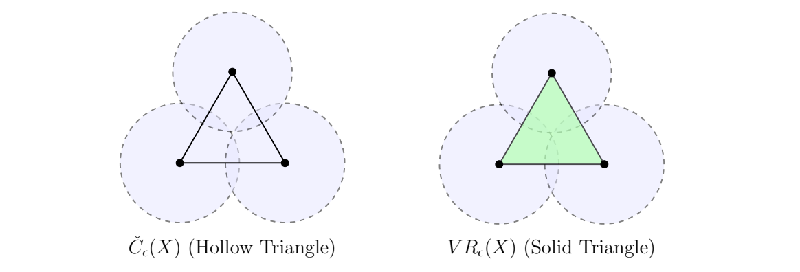

> [!ex] [Exercise 05 (Equilateral Triangle Complexes)](Exercise%2005%20%28Equilateral%20Triangle%20Complexes%29.md): Let $X=\{x_1,x_2,x_3\}\subseteq\mathbb{R}^{2}$ be an equilateral triangle of side $d=2$.  
> (a) Sketch $\operatorname{VR}_{1}(X)$ and decide whether it contains a $2$-simplex.  
> (b) Calculate the circumradius.  
> (c) Sketch $\check{C}_{1}(X)$ and decide whether it contains a $2$-simplex.  
> (d) Verify $\check{C}_{1}(X)\subseteq\operatorname{VR}_{1}(X)\subseteq\check{C}_{\sqrt{2}}(X)$.

###### Solution.
> [!sol] *Solution.* **(a)** At scale $\epsilon=1$, every pair of vertices is at distance $2=2\epsilon$. All three edges are present, and the clique criterion in [Definition 32 (Vietoris-Rips Complex)](../Definition%2032%20%28Vietoris-Rips%20Complex%29.md) gives the $2$-simplex $\{x_1,x_2,x_3\}$. Thus $\operatorname{VR}_1(X)$ is the filled triangle.
>
> **(b)** Let $c$ be the circumcenter and $m$ the midpoint of the side joining $x_1$ and $x_2$. The segment from $c$ to $m$ is perpendicular to that side, and $x_1c$ bisects the $60^\circ$ angle at $x_1$. Hence the circumradius $R$ satisfies $R\cos 30^\circ=\|x_1-m\|=1$, so $R=2/\sqrt{3}$.
>
> **(c)** Each pair of closed unit disks touches at the midpoint of the corresponding side, so all three edges belong to $\check{C}_1(X)$ by [Definition 31 (Čech Complex)](../Definition%2031%20%28%C4%8Cech%20Complex%29.md). The disks centered at $x_1$ and $x_2$ meet only at $m$. Any common point must attain equality in the triangle inequality between the two centers and have distance $1$ from each. Since $\|x_3-m\|=\sqrt{2^2-1^2}=\sqrt{3}>1$, the three disks have empty common intersection. Thus $\check{C}_1(X)$ is the hollow triangle.
>
> 
>
> **(d)** The circumcenter satisfies $\|c-x_i\|=2/\sqrt{3}<\sqrt{2}$ for every $i$. It lies in all three closed disks of radius $\sqrt{2}$, so $\check{C}_{\sqrt{2}}(X)$ contains the $2$-simplex and all its faces. Hence
>
> $$
> \check{C}_1(X)\subsetneq\operatorname{VR}_1(X)=\check{C}_{\sqrt{2}}(X).
> $$
>
> The strict inclusion adds exactly the simplex $\{x_1,x_2,x_3\}$. $\blacksquare$

###### Dependencies.
- [Definition 31 (Čech Complex)](../Definition%2031%20%28%C4%8Cech%20Complex%29.md)
- [Definition 32 (Vietoris-Rips Complex)](../Definition%2032%20%28Vietoris-Rips%20Complex%29.md)
- [Lemma 02 (Čech and Vietoris-Rips Interleaving)](../Lemma%2002%20%28%C4%8Cech%20and%20Vietoris-Rips%20Interleaving%29.md)

###### References.
[1] Pamuk (2026 Fall) *Lecture*.

[2] Pamuk, M. (2026). *[MATH423: Introduction to Computational Topology: Lecture Notes](../_materials/Pamuk-3.pdf)* (pp. 9 (9)).

#mathematics #computational-topology #exercise
