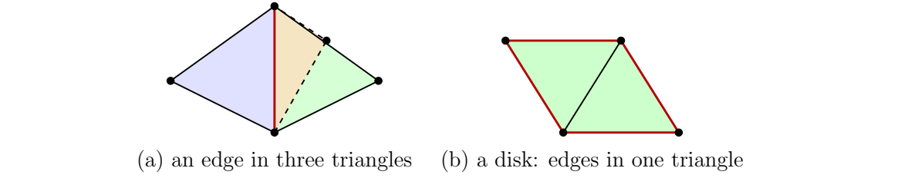

> [!lem] [Lemma 01 (Closed Surface Edge Incidence)](Lemma%2001%20%28Closed%20Surface%20Edge%20Incidence%29.md): In a triangulation of a closed surface, every edge is a face of exactly two triangles, and every vertex and edge is a face of at least one triangle.

> [!rem] Counting incident edge-triangle pairs gives $3F=2E$. Combining this with $V-E+F=\chi$ gives
>
> $$
> E=3(V-\chi),\qquad F=2(V-\chi).
> $$
>
> In particular, a sphere triangulation has $3V-6$ edges and $2V-4$ triangles, and every triangulated closed surface has an even number of triangles. A closed mesh with a million vertices has about three million edges and two million triangles when $\chi$ is negligible.

> [!rem] The relation $3n_2=2n_1$ gives $\chi=n_0-n_1/3$. If all vertices have degree $d$, then $2n_1=dn_0$ and $\chi=n_0(6-d)/6$. In particular if $d=5$ then $\chi=n_0/6>0$: the sphere needs $12$ vertices, as in the icosahedron, and the projective plane needs $6$.

###### Examples.
> [!eg] Ex. 1: 

> [!eg] Ex. 2: Three triangles sharing an edge do not give disk neighborhoods at its interior points. A disk mesh has outer edges in only one triangle and therefore has boundary. Mesh processing and three-dimensional printing software check for such non-manifold edges and holes.

> [!eg] Ex. 3: Every closed surface triangulation has an even number of triangles (see [Exercise 19 (Parity of Triangle Count)](Exercises/Exercise%2019%20%28Parity%20of%20Triangle%20Count%29.md)).

> [!eg] Ex. 4: $E=24$, and the surface is a torus or a Klein bottle (see [Exercise 37 (Eight-Vertex Surface Triangulation)](Exercises/Exercise%2037%20%28Eight-Vertex%20Surface%20Triangulation%29.md)).

> [!eg] Ex. 5: The lower bounds are $4$, $7$, and $9$ vertices (see [Exercise 38 (Vertex Bounds for Closed Surfaces)](Exercises/Exercise%2038%20%28Vertex%20Bounds%20for%20Closed%20Surfaces%29.md)).

> [!eg] Ex. 6: The incidence and count formulas hold, and the torus requires $V\geq7$ (see [Exercise 69 (Surface Counts and Torus Bound)](Exercises/Exercise%2069%20%28Surface%20Counts%20and%20Torus%20Bound%29.md)).

> [!eg] Ex. 7: The cases are the sphere and either the torus or the Klein bottle (see [Exercise 88 (Identifying Surfaces by Counts)](Exercises/Exercise%2088%20%28Identifying%20Surfaces%20by%20Counts%29.md)).

###### Proof.
> [!pf] *Proof.* Proof sketch. If an edge $e$ lies in exactly $k$ triangles and $x$ is interior to $e$, then for $k=0$ a small neighborhood is an interval rather than a disk: deleting a point disconnects the former but not the latter. For $k\geq1$, the neighborhood is a book of $k$ half-disks joined along their common diameter. For $k=1$ it is a half-disk and $x$ is a boundary point; for $k=2$ it is a disk; for $k\geq3$ it is not a disk. A rigorous justification of the last claim uses local homology in Week 5: the book has local homology rank $k-1$, whereas a disk has rank $1$. Thus $k=2$. A vertex or edge in no triangle similarly has a graph neighborhood rather than a disk. Each triangle contributes three incident pairs and each edge contributes two, yielding $3F=2E$. $\blacksquare$

> [!pf] *Proof.* For the case of $k\geq1$ incident triangles, the local argument can also use [Theorem 15 (Local Homology from Links)](Theorem%2015%20%28Local%20Homology%20from%20Links%29.md): the link of a subdivision point in the edge has $b_1=k-1$, whereas a disk neighborhood requires $b_1=1$. Hence $k=2$. $\blacksquare$

###### Dependencies.
- [Definition 14 (Closed Manifold)](Definition%2014%20%28Closed%20Manifold%29.md)
- [Definition 10 (Triangulation)](Definition%2010%20%28Triangulation%29.md)
- [Definition 26 (Euler Characteristic)](Definition%2026%20%28Euler%20Characteristic%29.md)
- [Theorem 15 (Local Homology from Links)](Theorem%2015%20%28Local%20Homology%20from%20Links%29.md)
- [Theorem 06 (Classification of Closed Surfaces)](Theorem%2006%20%28Classification%20of%20Closed%20Surfaces%29.md)

###### References.
[1] Pamuk (2026 Fall) *Lecture*.

[2] Pamuk, M. (2026). *[Triangulations, Classification of Surfaces and Abstract Simplicial Complexes](_materials/Pamuk-2.pdf)* (pp. 2 (2), 3 (3), 4 (4)).

[3] Pamuk, M. (2026). *[Midterm 1 Preparation Worksheet](_materials/Pamuk%20-%20Midterm%201%20Preparation%20Worksheet.pdf)* (pp. 1 (1), 2 (2), 3 (3), 5 (5), 7 (7), 8 (8), 11 (11)).

[4] Pamuk, M. (2026). *[Worked Calculations for Sections 6.1–6.4](_materials/Pamuk-Applications-3.pdf)* (pp. 8 (8)).

[5] Pamuk, M. (2026). *[Lecture notes on simplicial homology](_materials/Pamuk-4.pdf)* (pp. 9 (9), 17 (17), 18 (18), 19 (19)).

#mathematics #computational-topology #lemma
